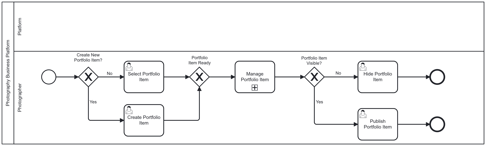
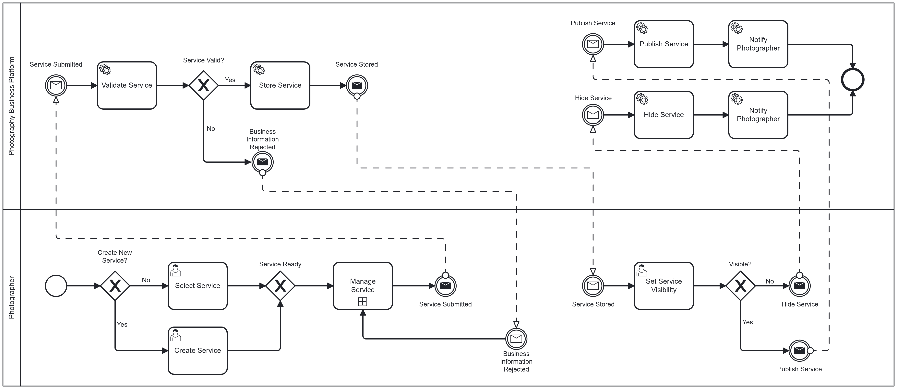
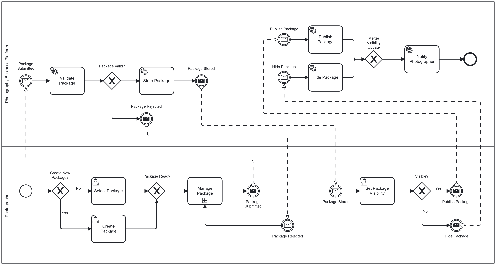
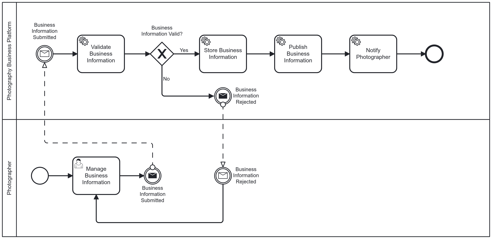
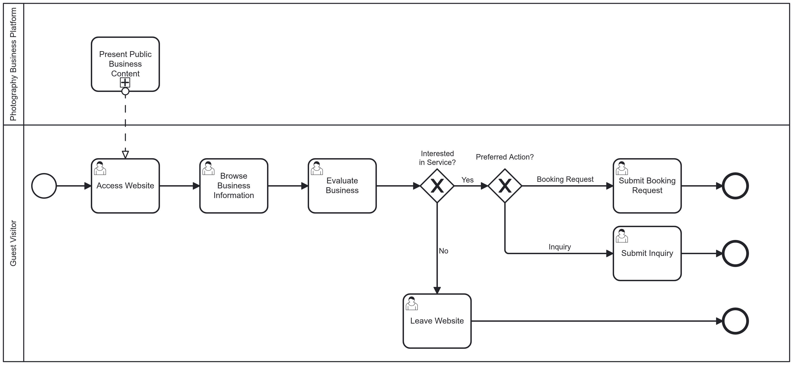
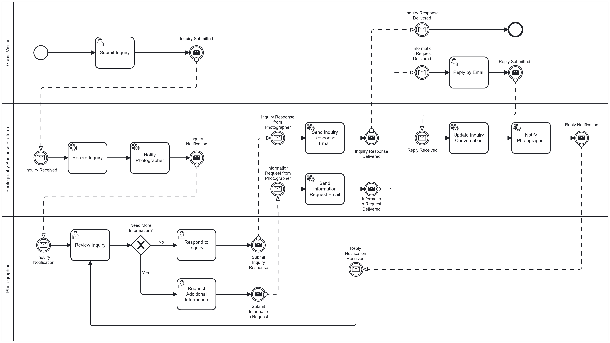
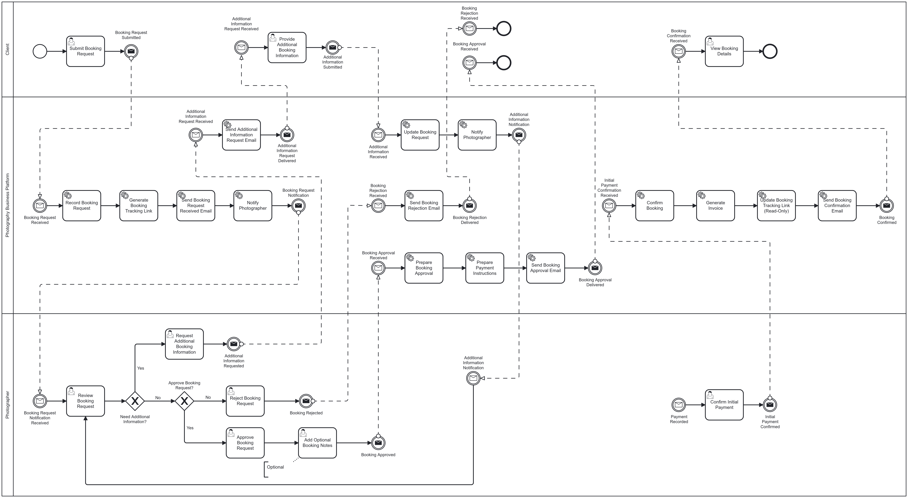
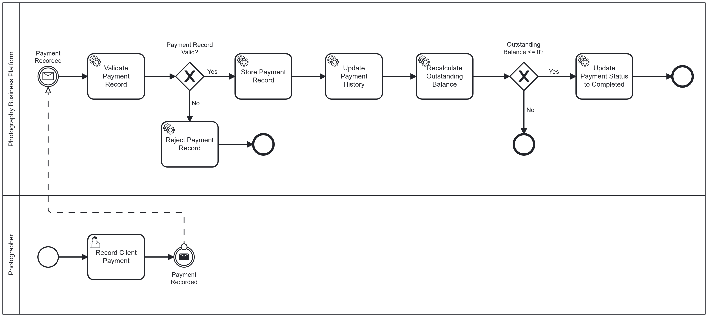
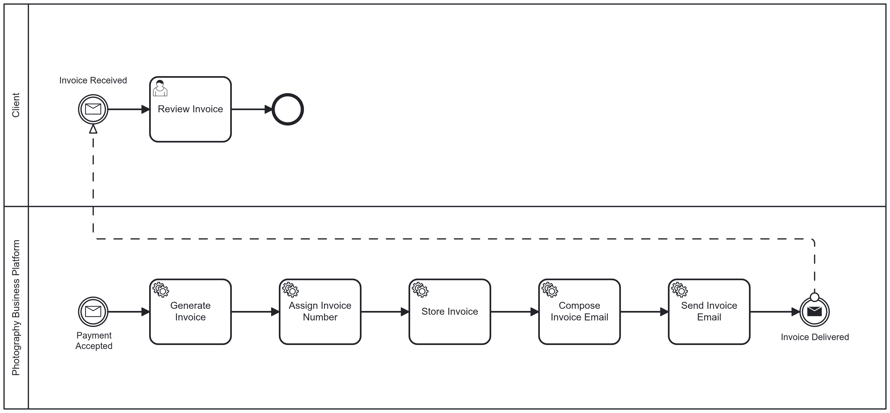

# Business Process

## Purpose

This document defines the core business processes of the Photography Business Platform.

The business processes describe how business activities are performed to achieve specific business outcomes throughout the lifecycle of the photography business.

They provide the business workflow baseline for business analysis, software design, implementation, and testing.

---

## Scope

The business processes defined in this document apply to Version 1.0 of the Photography Business Platform.

They describe the business workflows performed by the photographer, guest visitors, clients, and the platform, from business setup through client engagement, service delivery, and financial management.

---

## Process Groups

The business processes are organized into four process groups that represent the business lifecycle of the Photography Business Platform.

Each process group contains one or more related business processes that contribute to a common business objective:

- Business Setup
- Client Engagement
- Service Delivery
- Financial Management

---

## Business Setup

The Business Setup process group contains the business processes that prepare and maintain the business assets presented to potential clients.

These processes enable the photographer to organize the portfolio, define photography services and service packages, and maintain accurate business information before client interaction begins. 

The Business Setup process group consists of the following business processes:

### BP-01 — Portfolio Management

#### Objective

To enable the photographer to organize, maintain, and present a professional portfolio that showcases previous work and helps potential clients evaluate the quality and style of the photography business.

#### Description

Portfolio Management is the business process through which the photographer creates, organizes, updates, and maintains portfolio content presented on the public website.

The process includes creating, updating, organizing, showing, and hiding portfolio items, albums, and categories to ensure that the portfolio accurately reflects the photographer's professional work and remains relevant to potential clients.

The portfolio is intended to support client acquisition by demonstrating previous photography projects and encouraging visitors to request photography services.

#### Business Flow

1. The photographer creates a new portfolio item or selects an existing portfolio item.
2. The photographer manages the portfolio information, images, albums, and categories.
3. The photographer submits the portfolio item.
4. The platform validates the submitted portfolio information.
5. The platform stores the portfolio item.
6. The photographer decides whether the portfolio item should be publicly visible.
7. The platform publishes or hides the portfolio item accordingly.
8. Guest visitors and clients browse published portfolio items through the public website.
9. The photographer repeats portfolio management activities whenever necessary to keep the portfolio current and relevant.

#### Business Rules

- Only the photographer may create, modify, publish, hide, or remove portfolio content.
- A portfolio item shall contain at least one image.
- Portfolio items may belong to multiple albums.
- Portfolio items may belong to multiple categories.
- Albums may contain multiple portfolio items.
- Categories may classify multiple portfolio items.
- Descriptive information for a portfolio item is optional.
- Portfolio items may exist in one of two visibility states; Visible (publicly accessible), or Hidden (not publicly accessible).
- Only published portfolio items shall be visible to guest visitors and clients.
- Hidden portfolio items shall not be publicly visible.
- The platform shall discourage unauthorized copying of portfolio images in accordance with the portfolio protection policy.

#### Business Outcome

- The photography business maintains an accurate and up-to-date professional portfolio.
- Visitors and clients can browse the photographer's published work.
- The portfolio continuously reflects the photographer's current photography style and capabilities.
- Hidden portfolio items remain unavailable to public visitors.

#### BPMN Diagram

---

### BP-02 — Service Management

#### Objective

To enable the photographer to create, maintain, and organize the photography services offered by the business, ensuring that clients can clearly understand the available services before requesting a booking.

#### Description

Service Management is the business process through which the photographer creates, updates, hides, or removes photography services offered by the business.

Each service represents a type of photography or media production that may later be used independently or included within one or more service packages.

The maintained services are presented throughout the platform to support service discovery, booking requests, and package composition.

#### Business Flow

1. The photographer creates a new service or selects an existing service.
2. The photographer defines or updates the service information.
3. The photographer saves the service.
4. The platform validates the submitted information.
5. The platform stores the service information.
6. The photographer chooses whether the service should be publicly visible or hidden.
7. The platform publishes or hides the service accordingly.

#### Business Rules

- Only the photographer may create, modify, hide, publish, or remove services.
- Service name is mandatory.
- Service description is optional.
- Service pricing is optional because prices may be negotiated or determined through packages.
- Estimated service duration is optional.
- A service may belong to zero or more packages.
- A package may contain one or more services.
- Only visible services shall appear on the public website.
- Hidden services shall not be publicly accessible.
- Removing a service that is currently referenced by an active package shall not be permitted.
- The platform shall validate mandatory fields before storing the service.

#### Business Outcome

- The business maintains an accurate catalog of photography services.
- Clients can discover currently available services.
- A service shall be created once and may be included in multiple packages.

#### BPMN Diagram

---

### BP-03 — Package Management

#### Objective

To enable the photographer to create, maintain, and organize photography service packages that combine one or more services into structured commercial offerings presented to potential clients.

#### Description

Package Management is the business process through which the photographer creates, updates, publishes, hides, and maintains photography service packages.

A package represents a commercial offering that groups one or more existing photography services into a predefined solution for clients.

Packages simplify service presentation, support marketing activities, and help clients understand available photography offerings.

#### Business Flow

1. The photographer creates a new package or selects an existing package.
2. The photographer manages the package information.
3. The photographer selects one or more existing services to include in the package.
4. The photographer saves the package.
5. The platform validates the submitted package information.
6. The platform stores the package.
7. The photographer decides whether the package should be publicly visible.
8. The platform publishes or hides the package accordingly.

#### Business Rules

- Only the photographer may create, modify, publish, hide, or remove packages.
- Package name is mandatory.
- A package shall contain at least one existing service.
- A service may belong to multiple packages.
- Package description is optional.
- Package price is optional.
- Only visible packages shall be displayed on the public website.
- Hidden packages shall not be publicly accessible.
- The platform shall validate mandatory fields before storing the package.
- A package shall reference existing services only.

#### Business Outcome

- The photography business maintains a consistent catalog of commercial packages.
- Clients can browse structured photography offerings.
- Existing services are reused without duplication across multiple packages.

#### BPMN Diagram

---

### BP-04 — Business Information Management

#### Objective

To enable the photographer to manage the public business information presented on the platform, ensuring that visitors and clients always have access to accurate, complete, and up-to-date information about the photography business.

#### Description

Business Information Management is the business process through which the photographer maintains the public identity of the photography business.

The process includes creating, updating, and maintaining business information displayed throughout the platform, including contact information, business profile, working hours, location, communication channels, and other public business details.

The maintained information is used across the platform to support customer communication, service discovery, booking activities, and overall business credibility.

#### Business Flow

1. The photographer opens the business information management page.
2. The photographer reviews the current business information.
3. The photographer creates or updates the required business information.
4. The photographer saves the changes.
5. The platform validates the submitted information.
6. The platform stores the updated business information.
7. The updated information becomes immediately available throughout the platform.

#### Business Rules

- Only the photographer may create or modify business information.
- Business name is mandatory.
- At least one contact method shall be provided.
- Business description is optional.
- Business logo is optional.
- Working hours are optional.
- Business location is optional.
- Social media links are optional.
- Supported payment methods are optional.
- Changes become publicly visible immediately after successful saving.
- The platform shall validate mandatory fields before saving.

#### Business Outcome

- The photography business maintains an accurate public profile.
- Visitors and clients always access the latest business information.
- The platform displays consistent business information across all public pages.

#### BPMN Diagram

---

## Client Engagement

The Client Engagement process group contains the business processes through which potential clients discover the business, request information, and initiate communication with the photographer.

The Client Engagement process group consists of the following business processes:

### BP-05 — Client Acquisition

#### Objective

To attract potential clients, present the photography business, and encourage visitors to submit booking requests.

#### Description

Client Acquisition is the business process through which guest visitors discover the photography business, explore its public content, evaluate the photographer's work and services, and decide whether to submit a booking request.

The process begins when a visitor accesses the public website and ends when the visitor either submits a booking request or leaves the website without taking further action.

#### Business Flow

1. A guest visitor accesses the public website.
2. The visitor explores the portfolio, services, packages, and business information.
3. The visitor evaluates whether the photography business meets their needs.
4. The visitor may submit an inquiry, submit a booking request, or leave the website without further interaction.

#### Business Rules

- Public business information shall be accessible without authentication.
- Published portfolio items shall be visible to all visitors.
- Photography services and packages shall be publicly accessible.
- Visitors are not required to create an account before submitting an inquiry or a booking request.
- A booking request marks the successful completion of the client acquisition process.

#### Business Outcome

A visitor either becomes a client by submitting a booking request or leaves the website without initiating business interaction.

#### BPMN Diagram

---

### BP-06 — Inquiry Management

#### Objective

To enable potential clients to request information about the photography business and allow the photographer to respond efficiently before a booking request is submitted.

#### Description

Inquiry Management is the business process through which guest visitors submit inquiries, receive responses from the photographer, and obtain the information required before deciding whether to request a booking.

The process begins when a visitor submits an inquiry and ends when the inquiry is answered and closed.

#### Business Flow

1. A guest visitor submits an inquiry through the platform or by email.
2. The platform records the inquiry and notifies the photographer.
3. The photographer reviews the inquiry.
4. The photographer responds to the inquiry through the platform.
5. The platform sends the response to the visitor by email.
6. The visitor may continue the conversation by replying by email.
7. The platform records each reply and updates the inquiry conversation.
8. The inquiry is closed when no further communication is required.

#### Business Rules

- Guest visitors may submit inquiries without creating an account.
- The platform shall record every inquiry and every subsequent reply.
- The platform shall maintain the complete conversation history for each inquiry.
- Visitors may continue an inquiry by replying to the notification email.
- Email replies shall be automatically associated with the corresponding inquiry whenever possible.
- An inquiry does not create a booking.

#### Business Outcome

The visitor receives the requested information and either proceeds to submit a booking request or ends the interaction without requesting a booking.

#### BPMN Diagram

---

## Service Delivery

The Service Delivery process group contains the business processes required to evaluate, confirm, and manage photography bookings until the requested service is delivered.

The Service Delivery process group consists of the following business processes:

### BP-07 — Booking Management

#### Objective

To evaluate booking requests, negotiate booking details when necessary, confirm accepted bookings after the required initial payment has been confirmed, and manage confirmed bookings until the requested photography service has been completed.

#### Description

Booking Management is the business process through which booking requests are evaluated, negotiated when necessary, confirmed, and managed throughout the photography service lifecycle.

The process begins when a client submits a booking request. The platform records the request and immediately sends a booking request confirmation email containing a unique booking tracking link. Until the booking has been confirmed, the client may use this link to review, update, or cancel the booking request.

The photographer reviews the booking request and may request additional booking information before making a decision. The client provides the requested information when necessary, and both parties may continue refining the booking details until the photographer reaches a decision.

If the photographer rejects the booking request, the booking process ends.

If the photographer approves the booking request, the photographer may optionally include booking notes or instructions for the client. The platform then sends the booking approval, the payment instructions for the required initial payment, and any booking notes to the client.

After the client completes the required initial payment and the photographer confirms its receipt, the platform automatically confirms the booking.

Once the booking has been confirmed, responsibility for managing all booking modifications is transferred exclusively to the photographer. The booking tracking link remains available to the client but becomes read-only, allowing the client to view the latest booking information maintained by the photographer, including the agreed services or package, pricing, payment status, scheduled sessions, photographer notes, and other booking details.

The process ends when the confirmed booking has been completed or otherwise closed according to the business policies.

#### Business Flow

1. A client submits a booking request.
2. The platform records the booking request.
3. The platform sends a booking request confirmation email containing a unique booking tracking link.
4. The photographer reviews the booking request.
5. The photographer may request additional booking information.
6. The client provides the requested information when required.
7. The client may update or cancel the booking request through the booking tracking link before the booking has been confirmed.
8. The photographer either approves or rejects the booking request.
9. If the booking request is rejected, the process ends.
10. If the booking request is approved, the photographer may optionally provide booking notes or instructions for the client.
11. The platform sends the booking approval, payment instructions, and any booking notes to the client.
12. The client completes the required initial payment.
13. The photographer records and confirms the received payment.
14. The platform automatically confirms the booking.
15. The booking tracking link becomes read-only.
16. The photographer manages the confirmed booking throughout the service lifecycle until the photography service has been completed.

#### Business Rules

- Clients may submit booking requests without creating an account.
- Every booking request shall be recorded by the platform.
- The platform shall generate a unique booking tracking link for every booking request.
- The booking tracking link shall allow the client to review, update, or cancel the booking request until the booking has been confirmed.
- The photographer may request additional booking information before making a decision.
- Clients may update a booking request only before the booking has been confirmed.
- Clients may cancel a booking request only before the booking has been confirmed.
- A booking request may be approved or rejected by the photographer.
- The photographer may optionally include booking notes when approving a booking request.
- The platform shall send the booking approval, payment instructions, and any booking notes together.
- An approved booking request shall not become a confirmed booking until the photographer confirms the required initial payment.
- The platform shall automatically confirm the booking immediately after the photographer confirms the required initial payment.
- The required initial payment may be zero when explicitly determined by the photographer according to the business policies.
- Every confirmed payment shall be associated with the corresponding booking.
- After booking confirmation, the booking tracking link shall become read-only.
- The read-only booking tracking page shall always display the latest booking information maintained by the photographer.
- Photographer notes shall remain associated with the booking and be visible through the booking tracking page.
- After booking confirmation, booking modifications shall be performed only by the photographer.
- A confirmed booking may consist of one or more photography sessions.
- A photography session may span one or more calendar days.
- A confirmed booking remains active until the photography service has been completed or otherwise closed according to the business policies.

#### Business Outcome

The booking request is either rejected or automatically converted into a confirmed booking after the required initial payment has been confirmed. The client retains read-only access to the latest booking information through the booking tracking link, while the photographer manages the confirmed booking until the photography service has been completed.

#### BPMN Diagram

---

## Financial Management

The Financial Management process group contains the business processes responsible for recording payments and maintaining financial records related to client bookings.

The Financial Management process group consists of the following business processes:

### BP-08 — Payment Management

#### Objective

To record, verify, and manage client payments associated with confirmed bookings while maintaining accurate payment records and updating the financial status of each booking.

#### Description

Payment Management is the business process through which the photographer records and confirms payments received from clients for confirmed bookings.

The platform maintains a complete payment history for every booking, updates the booking balance after each confirmed payment, and determines whether the booking has satisfied its financial obligations.

The process begins when the photographer receives a payment from the client outside the platform and ends when the payment is confirmed and the booking financial status is updated.

#### Business Flow

1. The photographer receives a payment from the client outside the platform.
2. The photographer records the payment in the platform.
3. The platform validates the payment information.
4. The photographer reviews the recorded payment.
5. The photographer confirms the payment.
6. The platform updates the booking payment history.
7. The platform recalculates the booking balance.
8. If the confirmed payment satisfies the booking confirmation requirement, the platform marks the booking as confirmed.
9. If the remaining booking balance becomes zero, the platform marks the booking as fully paid.

#### Business Rules

- Payments shall only be recorded for existing bookings.
- Payments are recorded and confirmed only by the photographer.
- Every payment shall belong to exactly one booking.
- A booking may contain one or multiple payments.
- Every confirmed payment shall update the booking balance.
- The booking shall become confirmed only when the booking confirmation payment requirement is satisfied.
- A booking shall be marked as fully paid only when the remaining balance equals zero.
- The platform shall preserve the complete payment history for every booking.
- Clients cannot record, modify, confirm, or delete payments.

#### Business Outcome

The payment is successfully recorded, confirmed, and reflected in the booking's financial status, ensuring that the booking balance and payment history remain accurate throughout the booking lifecycle.

#### BPMN Diagram

---

### BP-09 — Invoice Management

#### Objective

Generate, maintain, and deliver invoices for recorded client payments while ensuring accurate financial documentation and maintaining complete financial records for each booking.

#### Description

This business process is responsible for generating invoices after valid payment records have been accepted. The platform creates an invoice linked to the corresponding payment, assigns a unique invoice number, stores the invoice, and delivers it to the client by email. The process ensures that every accepted payment is documented consistently without affecting the booking lifecycle.

Each generated invoice shall contain sufficient financial and business information to uniquely identify the payment transaction and its relationship to the associated booking.

#### Business Flow

1. A valid payment record is available.
2. The platform generates an invoice.
3. The platform assigns a unique invoice number.
4. The platform stores the invoice.
5. The platform prepares the invoice email.
6. The platform sends the invoice to the client.
7. The process ends.

#### Business Rules

- Every accepted payment must generate exactly one invoice.
- Invoice numbers must be unique.
- Invoice generation is performed automatically by the platform.
- Each invoice must be linked to exactly one payment record.
- A booking may have multiple invoices because payments may be made in installments.
- Invoice generation must not modify the booking lifecycle.
- Failure to deliver the invoice by email must not invalidate the generated invoice.

##### Invoice Content

Each invoice shall contain at least:

- Unique invoice number.
- Invoice issue date and time.
- Photographer business information.
- Client information.
- Related booking reference.
- Related payment reference.
- Payment date.
- Payment amount.
- Currency.
- Payment method.
- Description of the paid service(s).
- Amount paid.
- Remaining balance after the payment.
- Invoice status.

#### Business Outcome

- Every accepted payment is documented by an official invoice.
- Financial records remain complete and traceable.
- The client receives the invoice by email.
- The photographer can review all generated invoices.

#### BPMN Diagram

---

