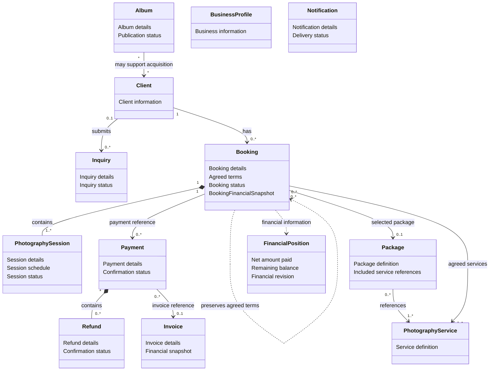

# Domain Model

## 1. Purpose

This document defines the conceptual domain model of the Photography Business Platform.

Its purpose is to identify the core business concepts, describe their relationships, and establish a shared understanding of the business domain before software implementation begins.

The domain model serves as a foundation for:

- Strategic Design
- Tactical Design
- Aggregate Design
- Database Design
- API Design
- Software Implementation

This document describes the business domain from a conceptual perspective. It intentionally avoids implementation details such as database tables, framework-specific classes, and technical architecture.

---

## 2. Scope

The domain model covers the business activities required to operate a single photography business.

The platform supports the client journey from discovering the photographer's work and submitting inquiries or booking requests through booking management, photography sessions, payments, and invoicing.

The domain includes:

- Portfolio Management
- Services & Packages
- Client Management
- Inquiry Management
- Booking Management
- Payment Management
- Invoice Management
- Business Information Management
- Notification Management

The following concerns are intentionally outside the scope of the domain model:

- Image editing
- Social networking
- Marketplace functionality
- Third-party accounting systems
- Physical equipment management
- Photographer payroll management
- Online payment gateway integration
- Client photo delivery and gallery workflows

---

## 3. Domain Overview

The Photography Business Platform is a business management system designed to support the operations of a single photography business.

The domain covers the activities required to attract potential clients, manage their inquiries and booking requests, coordinate photography sessions, record and confirm payments, and generate invoices.

The business revolves around one central concept:

> Delivering photography services through a managed booking lifecycle.

Booking Management represents the Core Domain. Other business capabilities support the booking lifecycle or provide independent business functionality.

### Domain Discovery

The domain model was derived from the project's business requirements, business process documentation, booking lifecycle, use cases, and ubiquitous language.

These artifacts were analyzed to identify the core business concepts, their relationships, and their boundaries before making software design decisions.

---

## 4. Domain Classification

Following Domain-Driven Design (DDD), the business domain is classified into three categories:

- Core Domain
- Supporting Domains
- Generic Subdomains

### 4.1 Core Domain

The Core Domain represents the primary business capability that delivers the platform's central business value.

For this project, the Core Domain is:

- Booking Management

Booking Management coordinates the booking lifecycle, including booking requests, booking terms, approval, confirmation, photography sessions, and booking completion.

It also evaluates financial information received from Payment Management to determine whether the booking's financial conditions for confirmation or completion have been satisfied.

### 4.2 Supporting Domains

Supporting Domains provide business capabilities that support the Core Domain or other business operations.

The Supporting Domains are:

- Client Management
- Services & Packages
- Inquiry Management
- Payment Management
- Invoice Management
- Portfolio Management
- Business Information

Payment Management is an independent Bounded Context responsible for payment recording, confirmation, and refunds. Its independence does not make it part of the Core Domain.

Portfolio Management is a Supporting Domain that supports public presentation of the photographer's work and client acquisition.

### 4.3 Generic Subdomains and Capabilities

Generic capabilities provide common functionality that is not specific to the photography business.

Examples include:

- Authentication
- Authorization
- Localization
- File Storage

Notification delivery is a cross-cutting capability with an explicit logical Notification Management context in the domain design.

---

## 5. Core Business Concepts

The following concepts form the conceptual foundation of the domain model.

### Client Management

- Visitor
- Client

### Inquiry Management

- Inquiry

### Services & Packages

- Photography Service
- Package

### Booking Management

- Booking Request
- Booking
- Photography Session
- Booking Financial Snapshot

### Payment Management

- Payment
- Refund
- Financial Position

### Invoice Management

- Invoice

### Portfolio Management

- Portfolio
- Album
- Category

### Business Information

- Photographer
- Business Profile

### Notification Management

- Notification

---

## 6. Relationships Between Concepts

The business concepts are related through the activities of attracting clients, managing inquiries and bookings, delivering photography sessions, recording payments, and generating invoices.

### 6.1 Client Acquisition

A `Visitor` may submit an `Inquiry` to request information about the photographer's services.

An `Inquiry` may be submitted by either a `Visitor` or an existing `Client` and remains independent of the booking lifecycle.

Submitting an Inquiry does not create a Client.

A Visitor becomes a Client when a Booking Request is submitted.

A `Client` is managed independently and may have multiple Bookings and Inquiries over time.

### 6.2 Service Selection

A `Client` may request one or more `Photography Services`.

A `Package` represents a predefined offering that includes one or more Photography Services.

A Booking may be based on a selected Package, individual Photography Services, or an agreed combination of services.

The Booking preserves the agreed service and pricing terms for that booking. Later changes to the service catalog or package definition must not silently change the terms of an existing Booking.

### 6.3 Booking

A `Booking Request` represents a client's request to obtain photography services and is a stage in the Booking lifecycle, not an independent Aggregate.

The request is reviewed by the Photographer and may be approved or rejected.

An approved request may proceed to confirmation according to the booking rules.

A `Booking` belongs to exactly one `Client` and represents the agreed business arrangement between the Client and the Photographer.

A Booking may contain one or more Photography Sessions.

### 6.4 Photography Sessions

A `Photography Session` represents a scheduled photography activity within a Booking.

A Booking may contain multiple sessions, potentially scheduled on different dates.

Each Photography Session belongs to exactly one Booking.

Photography Sessions are managed within the Booking consistency boundary. Their lifecycle changes are performed through the Booking Aggregate.

`PhotographySessionCompleted` is an internal domain event within Booking Management. It is not a cross-context integration event.

### 6.5 Payments and Financial Position

A `Payment` represents an individual payment recorded against a Booking.

A Booking may have multiple Payments, including installment payments.

Payment Management independently owns payment recording, confirmation, and refund processing.

A Payment is not part of the Booking Aggregate. It has its own lifecycle and consistency boundary.

The financial position of a Booking is derived by Payment Management from its confirmed payments and confirmed refunds.

The financial calculation is based on:

- Net Amount Paid = Confirmed Payments − Confirmed Refunds
- Remaining Balance = Agreed Total − Net Amount Paid

Pending or rejected payments are not included in the calculation.

Booking Management receives the relevant financial facts and maintains a `BookingFinancialSnapshot` for evaluating its own lifecycle rules.

The snapshot is not the authoritative financial record and does not make Payment part of the Booking Aggregate.

### 6.6 Invoices

An `Invoice` is generated for each individually confirmed Payment.

Each Invoice is associated with exactly one Payment and its corresponding Client.

An Invoice preserves the financial information applicable at the time of generation, including:

- The individual confirmed payment
- Cumulative confirmed payments
- Confirmed refunds where applicable
- Remaining balance

Invoice generation is independent of whether the Booking has been fully paid.

Generating an Invoice and delivering it to the Client are separate activities. Successful generation does not imply successful email delivery.

### 6.7 Portfolio

The `Portfolio` represents the photographer's publicly presented work.

A Portfolio contains `Albums`, which organize portfolio content.

An `Album` is managed as an independent business unit with its own lifecycle, including creation, updating, publishing, and unpublishing.

Categories organize or classify portfolio content.

Portfolio Management supports client acquisition but remains independent of the Booking lifecycle.

### 6.8 Business Information

The Photographer maintains a `Business Profile` containing the business information presented to visitors and clients.

Business Profile management is independent of individual Bookings.

### 6.9 Notifications

A `Notification` represents a notification delivery request or record associated with a business activity.

Notification Management coordinates notification delivery in response to relevant business events.

It does not own the business state that caused the notification.

---

## 7. Aggregate Boundaries and Ownership

Strategic Design and Tactical Design established the following Aggregate Roots and consistency boundaries.

An Aggregate is a consistency boundary that protects business invariants. Its Aggregate Root is the entry point through which changes to the Aggregate are performed.

The following table summarizes the approved boundaries.

| Bounded Context | Aggregate Root | Consistency Boundary |
|---|---|---|
| Booking Management | `Booking` | Booking lifecycle, agreed terms, Photography Sessions, and booking financial snapshot |
| Client Management | `Client` | Client information and lifecycle |
| Services & Packages | `PhotographyService` | Individual service definition |
| Services & Packages | `Package` | Package definition and included service references |
| Payment Management | `Payment` | Individual payment, confirmation state, and associated refunds |
| Invoice Management | `Invoice` | Invoice data and its preserved financial snapshot |
| Inquiry Management | `Inquiry` | Inquiry details and status |
| Portfolio Management | `Album` | Album information, content organization, and publication lifecycle |
| Business Information | `BusinessProfile` | Business profile information |
| Notification Management | `Notification` | Notification request, delivery state, and retry lifecycle |

### 7.1 Booking Aggregate

`Booking` is the Aggregate Root of Booking Management.

Its consistency boundary includes:

- Booking details and lifecycle status
- Agreed booking terms
- Required Photography Sessions
- Booking Financial Snapshot

`PhotographySession` is an internal Entity within the Booking Aggregate.

Changes to a Photography Session are performed through the Booking Aggregate to protect booking-level invariants, including the conditions required for booking completion.

`BookingFinancialSnapshot` is maintained for Booking Management's own lifecycle decisions. It is not an authoritative financial ledger and does not contain Payment Aggregates.

### 7.2 Payment Aggregate

`Payment` is an independent Aggregate Root in Payment Management.

Each Payment has its own lifecycle and consistency boundary.

A Payment may contain one or more associated Refund Entities. A Refund is not a separate Aggregate Root.

Payment Management owns the authoritative payment and refund records.

### 7.3 Financial Position

The `Financial Position` is a calculated projection derived from confirmed payments and confirmed refunds.

It is not an Aggregate Root.

Payment Management calculates and provides the financial facts required by other contexts without transferring ownership of its Payment Aggregates.

### 7.4 Invoice Aggregate

`Invoice` is an independent Aggregate Root in Invoice Management.

An Invoice is generated for one individually confirmed Payment and preserves the relevant financial information at generation time.

The relationship between Payment and Invoice must ensure that no more than one Invoice is generated for the same Payment.

Invoice delivery is managed separately from Invoice generation.

### 7.5 Services and Packages Aggregates

`PhotographyService` and `Package` are independent Aggregate Roots within Services & Packages.

A Photography Service has its own definition and lifecycle.

A Package has its own definition and lifecycle and maintains references to the Photography Services it includes.

The two concepts have separate consistency boundaries. Updating a service does not require modifying the Package Aggregate, and updating a Package does not require modifying its referenced Photography Services.

### 7.6 Other Aggregates

The remaining Aggregate Roots have the following responsibilities:

- `Client`: owns independently managed client information.
- `Inquiry`: owns an independent inquiry lifecycle.
- `Album`: owns album information, content organization, and publication lifecycle.
- `BusinessProfile`: owns the photographer's business profile information.
- `Notification`: owns the notification delivery lifecycle.

---

## 8. Domain Model Diagram

The following diagram illustrates the principal business concepts and their relationships.

It is a conceptual relationship diagram. Associations between Aggregates represent business relationships and references, not shared Aggregate ownership or a shared consistency boundary.

---

## 9. Design Notes

### 9.1 Booking as the Central Business Concept

`Booking` remains the central business concept because it coordinates the delivery of photography services to a Client.

However, its central business role does not mean that all related concepts belong to the Booking Aggregate.

Payments, Invoices, Clients, and service catalog definitions have independent Aggregate boundaries and are managed by their respective Bounded Contexts.

### 9.2 Client Independence

`Client` is managed independently from `Booking`.

A Client may exist without an active Booking and may have multiple Bookings over time.

Submitting an Inquiry does not create a Client. A Visitor becomes a Client when submitting a Booking Request.

### 9.3 Inquiry Independence

`Inquiry` is independent of the Booking lifecycle.

It may be submitted by a Visitor or an existing Client and follows its own lifecycle.

### 9.4 Booking Request

`Booking Request` is a stage in the Booking lifecycle rather than an independent Aggregate or Aggregate Root.

The Booking Aggregate manages the request and its progression through approval, confirmation, and subsequent lifecycle stages.

### 9.5 Payment and Booking Relationship

Payment Management owns Payment Aggregates and the authoritative financial records.

Booking Management does not directly modify Payment records. It receives financial information through cross-context integration and maintains its own Booking Financial Snapshot.

This separation preserves the independent consistency boundaries of Booking and Payment Management.

### 9.6 Payment and Invoice Relationship

Payment and Invoice are independent Aggregates in separate Bounded Contexts.

A confirmed Payment triggers Invoice generation.

Each confirmed Payment has at most one corresponding Invoice, and the Invoice preserves the relevant financial snapshot at generation time.

Invoice generation and notification delivery remain separate responsibilities.

### 9.7 Photography Services and Packages

Photography Services and Packages are independent Aggregates within the same Bounded Context.

Packages reference the services they include.

A Booking preserves the agreed service and pricing terms so that subsequent changes to the catalog do not silently alter an existing agreement.

### 9.8 Portfolio Management

Portfolio Management is a Supporting Domain independent of Booking Management.

`Album` is its Aggregate Root. The Portfolio is the overall business concept representing the photographer's public work, rather than an additional Aggregate Root.

### 9.9 Domain Events and Cross-Context Communication

Domain Events communicate significant changes within their owning Bounded Context.

Events intended to notify other Bounded Contexts are published as integration events through the agreed reliable event publication mechanism.

For example:

- `PhotographySessionCompleted` is internal to Booking Management.
- `PaymentConfirmed` is published by Payment Management for interested contexts.
- `InvoiceGenerated` is published by Invoice Management after successful generation.

Cross-context consumers must handle duplicate and potentially out-of-order event delivery safely.

The detailed event ownership and integration contracts are documented in `04-domain-events.md` and `02-tactical-design.md`.

### 9.10 Model Refinement

The conceptual model and Aggregate boundaries are established through the approved Strategic and Tactical Design documents.

Detailed database structures, field definitions, Value Object classifications, and persistence constraints will be specified in the relevant Database Design documents.

This document should remain focused on business concepts, relationships, and consistency boundaries rather than implementation-specific structures.

---

## 10. Related Documents

- `01-business-process.md`
- `02-use-cases.md`
- `03-booking-lifecycle.md`
- `04-domain-events.md`
- `05-ubiquitous-language.md`
- `03-architecture/06-clean-architecture.md`
- `04-design/01-strategic-design.md`
- `04-design/02-tactical-design.md`
- `04-design/database/01-conceptual-model.md`

---

## 11. Change History

| Version | Description |
|---|---|
| 1.0 | Initial conceptual domain model |
| 2.0 | Aligned domain concepts, Aggregate Roots, consistency boundaries, and cross-context ownership with the approved Strategic and Tactical Design |
