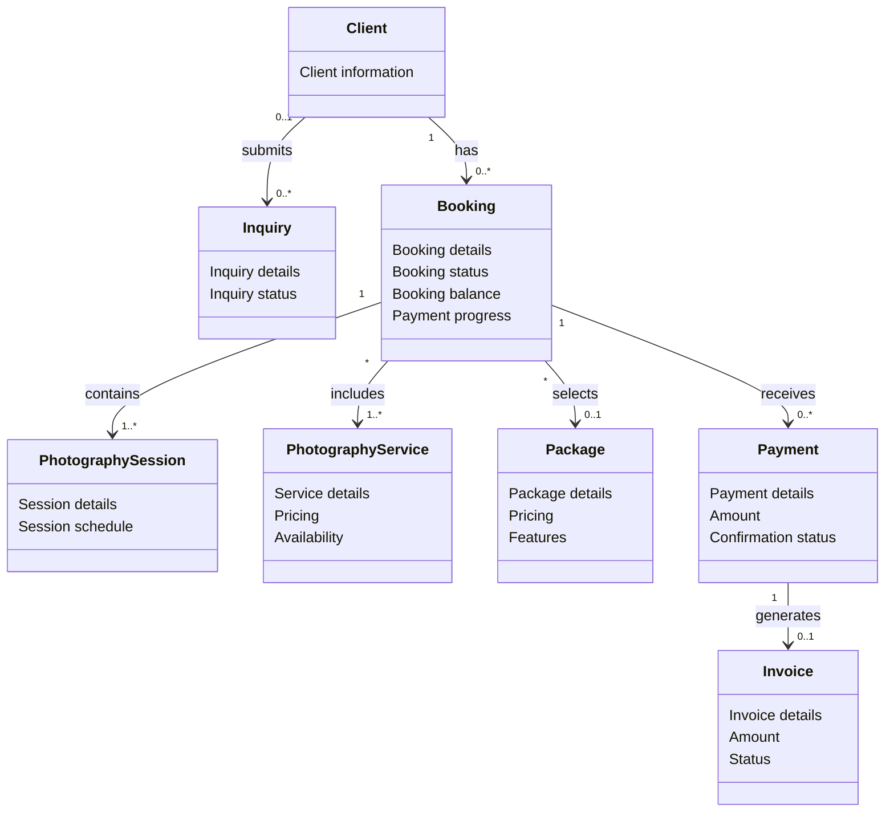

# Domain Model

## 1. Purpose

This document defines the conceptual domain model of the Photography Business Platform.

Its purpose is to identify the core business concepts, describe their relationships, and establish a shared understanding of the business domain before software implementation begins.

The domain model serves as the foundation for:

- Strategic Design
- Tactical Design
- Aggregate Design
- Database Design
- API Design
- Software Implementation

This document describes the business domain from a conceptual perspective and intentionally avoids implementation details such as database tables, framework-specific classes, or technical architecture.

---

## 2. Scope

The domain model covers the business activities required to operate a single photography business.

The platform focuses on managing the complete client journey, from the first inquiry through booking, photography sessions, payments, and invoicing.

The domain includes:

- Portfolio Management
- Photography Services
- Packages
- Client Inquiries
- Booking Management
- Photography Sessions
- Payment Management
- Invoice Management
- Business Information Management

The following concerns are intentionally outside the scope of the domain model:

- Image editing
- Social networking
- Marketplace functionality
- Third-party accounting systems
- Physical equipment management
- Photographer payroll management

---

## 3. Domain Overview

The Photography Business Platform is a business management system designed to support the operations of a single photography business.

The domain covers the complete lifecycle of photography services, from attracting potential clients through the public portfolio to managing bookings, photography sessions, payments, invoices, and business administration.

The business revolves around one central concept:

> Delivering photography services through a managed booking lifecycle.

Every business capability within the domain ultimately supports this lifecycle.

### Domain Discovery

The domain model was derived from the project's business requirements, business process documentation, booking lifecycle, use cases, and ubiquitous language.

These artifacts were analyzed to identify the core business concepts, their relationships, and the boundaries of the business domain before making any software design decisions.

---

## 4. Domain Classification

Following Domain-Driven Design (DDD), the business domain is divided into three categories:

- Core Domain
- Supporting Domains
- Generic Subdomains

### Core Domain

The Core Domain represents the primary business capability that differentiates the Photography Business Platform.

For this project, the Core Domain is:

- Booking Management

This domain coordinates the complete photography booking lifecycle, including booking requests, booking confirmation, photography sessions, payment progress, and the financial completion of bookings.

### Supporting Domains

Supporting Domains provide essential business capabilities that enable the Core Domain but do not represent the primary business value.

The supporting domains are:

- Portfolio Management
- Photography Services
- Package Management
- Inquiry Management
- Payment Management
- Invoice Management
- Business Information Management

### Generic Subdomains

Generic Subdomains provide common capabilities that are required by the system but are not specific to the photography business itself.

Examples include:

- Authentication
- Authorization
- Notifications
- Localization
- File Storage

---

## 5. Core Business Concepts

The Photography Business Platform is built around a set of business concepts that represent the language of the photography business.

The following concepts form the conceptual foundation of the domain model.

### Client Management

- Visitor
- Client
- Inquiry

### Service Management

- Photography Service
- Package

### Booking Management

- Booking Request
- Booking
- Photography Session

### Financial Management

- Payment
- Invoice

### Portfolio Management

- Portfolio
- Album
- Category

### Business Management

- Photographer

---

## 6. Relationships Between Concepts

The core business concepts are related through the business processes of attracting clients, requesting and managing bookings, delivering photography sessions, and processing payments.

### Client Acquisition

A `Visitor` may submit an `Inquiry` to request information about the photographer's services.

An `Inquiry` may be submitted by either a `Visitor` or an existing `Client` and remains independent from the booking lifecycle.

A `Visitor` becomes a `Client` when a `Booking Request` is submitted.

### Service Selection

A `Client` may request one or more `Photography Services`.

A `Photography Service` may be offered as part of a predefined `Package` or requested as a custom service.

### Booking

A `Booking Request` represents a client's request to obtain photography services and is subject to the photographer's review and approval.

Once approved, the request becomes a `Booking`.

A `Booking` belongs to one `Client` and may contain one or more `Photography Sessions`.

### Photography Sessions

A `Photography Session` represents a scheduled photography activity within a `Booking`.

A `Booking` may contain multiple sessions, and a session belongs to exactly one booking.

### Payments

A `Booking` may have one or more `Payments`.

Payments may be recorded as installments.

The booking's financial status is determined by the confirmed payments and the remaining balance.

### Invoices

An `Invoice` is generated for a confirmed `Payment`.

An `Invoice` is associated with the corresponding `Payment` and `Client`.

### Portfolio

A `Portfolio` represents the photographer's public work.

A `Portfolio` contains `Albums`, and `Albums` contain portfolio content organized using `Categories`.

Portfolio management is independent from the booking lifecycle but supports client acquisition.

---

## 6. Aggregate Candidates

At this stage, the following concepts are identified as potential Aggregate boundaries based on their business responsibilities, lifecycles, and consistency requirements.

Aggregates are identified as candidate consistency boundaries around business concepts that must be managed together to protect business invariants.

At this stage, the boundaries are considered candidates rather than final tactical design decisions. They will be refined during Tactical Design based on business invariants, transactional consistency requirements, and ownership rules.

### Booking

`Booking` is the primary aggregate candidate because it represents the central business transaction of the photography business.

The booking lifecycle requires consistency between:

- Booking status
- Photography Sessions
- Payment progress
- Remaining balance

`Booking` is therefore a strong candidate for an Aggregate Root.

### Portfolio

`Portfolio` is a candidate Aggregate because portfolio content is managed as a cohesive business capability.

Potentially related concepts include:

- Albums
- Portfolio Categories

`Portfolio` may act as the Aggregate Root for portfolio content that must be managed together.

### Invoice

`Invoice` is a candidate Aggregate because it represents a financial document with its own lifecycle and business rules.

The Invoice must remain internally consistent once generated and issued.

### Inquiry

`Inquiry` is a candidate Aggregate because it represents an independent communication between a potential or existing client and the Photographer.

Its lifecycle is independent from the Booking lifecycle.

### Client

`Client` is a candidate Aggregate because client information represents an independently managed business concept.

A Client may exist independently from a specific Booking and may have multiple Bookings over time.

This suggests that Client may have an independent Aggregate boundary.

### Payment

`Payment` is considered a candidate Entity within the Booking consistency boundary rather than an independent Aggregate at this stage.

A Payment contributes to the financial state of its related Booking, particularly:

- Confirmed payment amount
- Remaining balance
- Booking confirmation
- Fully paid status

Its final boundary will be validated during Tactical Design.

### Photography Session

`Photography Session` is considered a candidate Entity within the Booking consistency boundary.

A Session belongs to a Booking and its lifecycle is dependent on the related Booking.

### Photography Service

`Photography Service` is a candidate Aggregate because it is managed independently from individual Bookings.

It may be created, modified, activated, or deactivated by the Photographer without being part of a specific Booking.

Its final Aggregate boundary will be validated during Tactical Design.

### Package

`Package` is a candidate Aggregate because it is a predefined offering managed independently from individual Bookings.

A Booking may reference a selected Package, while the Package itself has its own lifecycle.

Its final Aggregate boundary will be validated during Tactical Design.

> These are preliminary Aggregate candidates rather than final tactical design decisions. Final Aggregate boundaries will be determined during Tactical Design based on business invariants, transactional consistency requirements, and ownership rules.

---

## 7. Domain Model Diagram

---

## 8. Design Notes

The current domain model is an initial strategic representation of the business domain.

The model intentionally focuses on business concepts and their relationships rather than implementation details, database structures, or final Aggregate boundaries.

Several relationships and boundaries remain subject to further refinement during Tactical Design.

### Booking as the Central Business Concept

`Booking` is currently modeled as the central business concept because it coordinates the delivery of photography services to a client.

Its lifecycle is related to:

- Photography Sessions
- Payment Progress
- Remaining Balance
- Invoice Generation

This does not yet imply that all related concepts must belong to the same Aggregate.

### Client Independence

`Client` is modeled independently from `Booking`.

A Client may exist without an active Booking and may have multiple Bookings over time.

This reflects the business requirement that the relationship with a Client is longer-lived than any individual Booking.

### Inquiry Independence

`Inquiry` is modeled independently from the Booking lifecycle.

An Inquiry may be submitted by a Visitor or by an existing Client.

Submitting an Inquiry does not create a Client.

A Visitor becomes a Client only when a Booking Request is submitted.

### Booking Request

`Booking Request` is currently treated as a stage in the Booking lifecycle rather than as an independent domain entity.

The distinction between a Booking Request and a confirmed Booking will be refined through the Booking lifecycle and Tactical Design.

### Payment and Invoice Relationship

`Payment` and `Invoice` are currently represented as separate domain concepts.

A confirmed Payment may result in the generation of an Invoice.

The exact ownership and Aggregate relationship between Payment, Invoice, and Booking will be determined during Tactical Design based on business invariants and consistency requirements.

### Photography Services and Packages

`Photography Service` and `Package` are managed independently from individual Bookings.

A Booking may select a Package and may include one or more Photography Services.

The exact representation of selected services and packages within a Booking will be refined during Tactical Design, particularly to determine whether the Booking requires its own representation of the agreed service details.

### Model Refinement

The current model is intentionally not considered a final tactical design.

The following decisions remain to be refined:

- Final Aggregate boundaries
- Aggregate Root ownership
- Entity versus Value Object classification
- Business invariants
- Ownership of relationships
- Domain Events
- Cross-Aggregate interactions

These decisions will be addressed during Tactical Design without changing the established Ubiquitous Language unless a new business discovery requires it.

---

