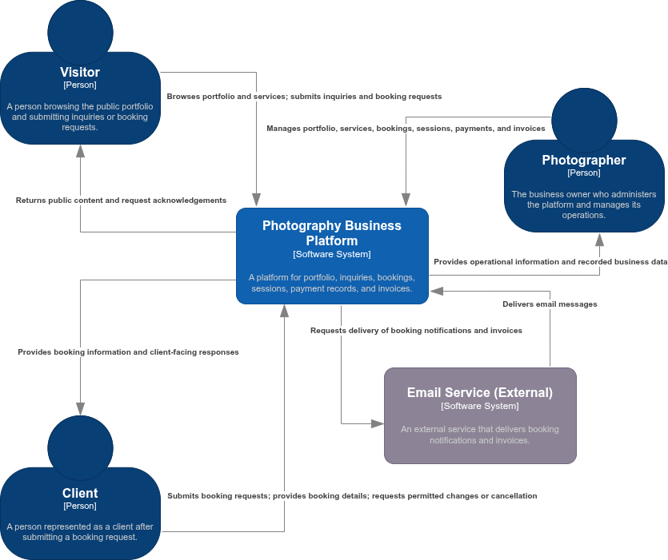

# C4 Context Diagram

## 1. Purpose

This document describes the system context of the Photography Business Platform using the C4 Model at Level 1.

The context diagram identifies the system boundary, its primary users, the external systems it interacts with, and the relationships between them. It provides a shared understanding of the platform's role within its operational environment before defining its containers and internal components.

---

## 2. Scope

The diagram covers the Photography Business Platform as a single system supporting one photography business.

It identifies the following people and external system:

- **Visitor:** A person who browses the public portfolio and services and may submit an inquiry or booking request.

- **Client:** A person represented as a client in the platform after submitting a booking request. A visitor may later become a client; the two roles do not necessarily represent different people.

- **Photographer:** The business owner and primary administrator who manages the platform's operational activities.

- **Email Service:** An external system used to deliver booking-related notifications and invoices to clients.

Submitting an inquiry alone does not create a client record or a booking. Visitors and clients are not required to create an account merely to submit an inquiry or booking request.

The specific email provider has not yet been selected.

---

## 3. C4 Context Diagram

The authoritative context diagram will be maintained as an editable draw.io file using the C4 shape library.

- **Editable source:** `docs/03-architecture/diagrams/03-c4-context.drawio`

- **Exported preview:** `docs/03-architecture/diagrams/03-c4-context.drawio.png`

The diagram represents the Photography Business Platform as one software system, with its people and external email service shown outside the system.

---

## 4. People and External System

### 4.1. Visitor

A person who accesses the public-facing platform without needing to be an existing client.

The visitor can:

- Browse the photography portfolio.
- Explore available services and packages.
- Submit an inquiry.
- Submit a booking request and provide the required information.

Submitting an inquiry alone does not create a client record or a booking. A visitor may subsequently become a client after submitting a booking request.

---

### 4.2. Client

A person who has submitted a booking request and is represented as a client in the platform's domain.

Depending on the booking's current status and applicable business rules, the client can provide booking details and request permitted changes or cancellation.

The client does not necessarily need an account merely to submit an inquiry or booking request. Authentication and authorization requirements for subsequent operations will be defined in the relevant requirements and design documents.

---

### 4.3. Photographer

The business owner and primary administrator of the platform.

The photographer uses the platform to manage:

- Portfolio content.
- Services and packages.
- Inquiries and booking requests.
- Booking and session information.
- Payment records and payment confirmations.
- Invoice generation and delivery status.

The photographer verifies received payments manually through the agreed external payment channel and records their confirmation in the platform. The platform does not process bank transfers or cash payments directly.

---

### 4.4. Email Service

An external system responsible for delivering emails requested by the platform.

The platform requests email delivery for relevant booking notifications and invoices. The email provider, integration details, retry behavior, and delivery-failure handling will be defined during subsequent design work.

Invoice generation and email delivery are separate responsibilities. A delivery failure does not mean that the invoice itself was not generated.

---

## 5. System Boundary and Responsibilities

The Photography Business Platform owns its application-level business workflows and records, including booking management, session tracking, payment records, and invoice generation.

The following activities remain outside the platform's direct control:

- Processing bank transfers or cash payments.
- Independently verifying external payment transactions.
- Delivering photography files through a full client gallery or file-delivery system.
- Operating the external email infrastructure.

The photographer records and confirms payments within the platform after verifying receipt through the agreed external payment channel.

---

## 6. Architectural Notes

1. The platform is a monolithic web application, as documented in `ADR-002-monolith.md`.
2. Laravel, Blade, Tailwind CSS, and JavaScript are implementation choices. They are intentionally not represented as separate systems in this context diagram.
3. The database, web application internals, and frontend implementation details belong in the C4 Container and Component diagrams.
4. No payment gateway or external payment-processing integration is assumed.
5. The email provider remains unspecified until an explicit design decision is made.
6. The diagram represents the intended system context. It does not imply that the application or external integrations have already been implemented.

---

## 7. Related Documents

| Document | Relationship |
|---|---|
| `docs/01-requirements/01-vision.md` | Defines the business vision. |
| `docs/01-requirements/04-assumptions-register.md` | Records assumptions affecting scope and design. |
| `docs/01-requirements/06-functional-requirements.md` | Defines the required business capabilities. |
| `docs/02-analysis/02-use-cases.md` | Documents the system's use cases. |
| `docs/02-analysis/03-booking-lifecycle.md` | Defines booking lifecycle rules. |
| `docs/02-analysis/04-domain-events.md` | Documents domain events. |
| `docs/02-analysis/05-ubiquitous-language.md` | Defines the shared domain terminology. |
| `docs/02-analysis/06-domain-model.md` | Describes the domain model. |
| `docs/03-architecture/01-system-overview.md` | Provides the high-level system description. |
| `docs/03-architecture/02-project-structure.md` | Defines the repository structure. |
| `docs/03-architecture/04-c4-container.md` | Describes the system's containers and their communication. |
| `docs/03-architecture/05-c4-component.md` | Describes internal application components. |
| `docs/03-architecture/06-clean-architecture.md` | Defines architectural boundaries and dependency rules. |
| `docs/03-architecture/adrs/ADR-002-monolith.md` | Records the monolithic architecture decision. |
| `docs/03-architecture/diagrams/03-c4-context.drawio` | Editable source of the C4 Context Diagram. |
| `docs/03-architecture/diagrams/03-c4-context.png` | Exported preview of the C4 Context Diagram. |

---

## 8. Document Maintenance

Update this document when an approved change affects the system boundary, primary users, external systems, or their relationships with the platform.

Any changes must remain consistent with the system overview, requirements, domain analysis, and accepted Architecture Decision Records.

**Current status:** Approved.

---
