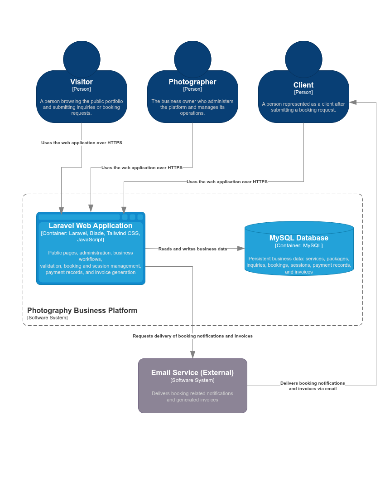

# C4 Container Diagram

## 1. Purpose

This document describes the Photography Business Platform using the C4 Model at Level 2 (Container).

It identifies the main runtime containers, their responsibilities, the data each container owns or processes, and the communication paths between them. It refines the system boundary defined in `03-c4-context.md` without introducing additional independently deployable services unless they are justified by an approved architectural decision.

---

## 2. Scope

The diagram represents the intended architecture of a monolithic web application for a single photography business.

It covers:

- Browser-based access to the platform by visitors, clients, and the photographer. The browser is an access channel and is not modeled as a container owned by the platform.
- The Laravel web application, including server-rendered Blade pages and application workflows.
- The relational database used to persist business data.
- The external email service used to deliver notifications and invoices.

The web browser is not represented as a separate container because the platform uses a server-rendered Laravel application rather than an independently deployable frontend application. Users access the application over HTTPS.

The diagram does not describe internal Laravel classes, DDD building blocks, individual domain components, database tables, or deployment-specific infrastructure. Those concerns belong in the relevant component, domain, database, and deployment design documents.

---

## 3. C4 Container Diagram

---

## 4. Containers

### 4.1. Laravel Web Application

**Type:** Server-side web application

**Technology:** Laravel, PHP, Blade, Tailwind CSS, and JavaScript.

Blade templates and server-side application logic execute within the Laravel web application. Tailwind CSS provides the styling for the rendered interface, while JavaScript executes in the user's browser to support client-side interactions and progressive enhancement.

**Responsibility:**

- Serves public portfolio and service pages.
- Accepts inquiries and booking requests.
- Validates input and enforces business rules.
- Manages services, packages, bookings, and sessions.
- Records payments and supports manual payment confirmation by the photographer.
- Generates a separate invoice for each payment confirmed by the photographer.
- Calculates the outstanding balance from the agreed total and recorded payments.
- Coordinates email delivery for relevant notifications and invoices.
- Enforces authentication and authorization for protected administrative operations according to the rules defined in the requirements and security design.

The application is the central runtime unit of the monolithic architecture. Its internal responsibilities will be decomposed into domain-oriented components in `05-c4-component.md` and the related DDD and Clean Architecture documents.

Payment processing remains outside the platform. The photographer verifies external payments and records their confirmation in the application. Invoice generation does not depend on the booking being fully paid; each confirmed payment can have its own invoice.

---

### 4.2. Relational Database

**Type:** Database container

**Technology:** MySQL, as specified by the project’s system overview.

**Responsibility:**

- Persists services and packages.
- Stores inquiries and booking information.
- Stores session information and the agreed booking terms.
- Records payments and their confirmation status.
- Persists invoice records and the information needed to reproduce them.
- Supports the application's transactional data operations.

The Laravel application accesses the database. The browser does not connect directly to it.

The exact schema, relationships, constraints, indexes, and migration strategy are defined in the database design documents.

---

### 4.3. External Email Service

**Type:** External software system

**Technology:** Provider and integration mechanism to be selected.

**Responsibility:**

- Delivers booking-related notifications.
- Delivers generated invoices to clients.
- Reports delivery outcomes where supported by the chosen integration.

The platform requests delivery; the external provider performs it. Invoice generation and email delivery are separate responsibilities. A delivery failure must not be treated as proof that the invoice was not generated.

Provider selection, retry behavior, failure handling, and delivery-status tracking will be specified in a subsequent design decision.

---

## 5. Container Communication

| Source | Destination | Purpose | Communication |
|---|---|---|---|
| Web Browser | Laravel Web Application | Submit requests and receive pages or responses | HTTPS |
| Laravel Web Application | Relational Database | Read and persist business data | Database connection |
| Laravel Web Application | Email Service | Request email delivery | Provider integration, such as SMTP or an API, to be decided |
| Email Service | Client | Deliver notifications and invoices | External email delivery |

The database and email provider are not accessed directly by the browser.

---

## 6. Architectural Decisions and Constraints

1. **Monolith:** Business workflows are handled by one Laravel application, consistent with `ADR-002-monolith.md`.
2. **Server-rendered interface:** Blade is part of the Laravel application rather than an independent frontend service, consistent with `ADR-003-blade.md`.
3. **Styling:** Tailwind CSS is a frontend styling technology, not a separate runtime container, consistent with `ADR-004-tailwind-css.md`.
4. **Database:** MySQL is the planned relational database technology, as stated in the system overview.
5. **External payments:** Bank transfers and cash payments are processed outside the platform. No payment gateway is included.
6. **Email:** The email provider has not been selected. The diagram does not imply a specific vendor or protocol.
7. **No separate services assumed:** The diagram does not introduce a standalone frontend application, microservices, a queue worker, a cache, or a separate file-delivery system without an approved requirement and architectural decision.
8. **Target architecture:** The diagram describes the planned system. It does not imply that the application has already been implemented or deployed.

---

## 7. Related Documents

| Document | Relationship |
|---|---|
| `docs/03-architecture/01-system-overview.md` | Defines the system's high-level architecture and technology choices. |
| `docs/03-architecture/02-project-structure.md` | Defines the repository structure. |
| `docs/03-architecture/03-c4-context.md` | Defines the system boundary, people, and external systems. |
| `docs/03-architecture/05-c4-component.md` | Defines the internal components of the Laravel application. |
| `docs/03-architecture/06-clean-architecture.md` | Defines the application’s architectural boundaries and dependency rules. |
| `docs/03-architecture/adrs/ADR-002-monolith.md` | Records the monolithic architecture decision. |
| `docs/03-architecture/adrs/ADR-003-blade.md` | Records the Blade decision. |
| `docs/03-architecture/adrs/ADR-004-tailwind-css.md` | Records the Tailwind CSS decision. |
| `docs/01-requirements/06-functional-requirements.md` | Defines the required business capabilities. |
| `docs/02-analysis/03-booking-lifecycle.md` | Defines booking lifecycle rules. |
| `docs/04-design/database/01-conceptual-model.md` | Defines the conceptual data model. |

---

## 8. Document Maintenance

Update this document when an approved decision changes a runtime container, its responsibility, its technology, its data ownership, or its communication with another container or external system.

Any changes must remain consistent with the system overview, C4 Context Diagram, requirements, domain analysis, and accepted Architecture Decision Records.

**Current status:** Approved.

---
