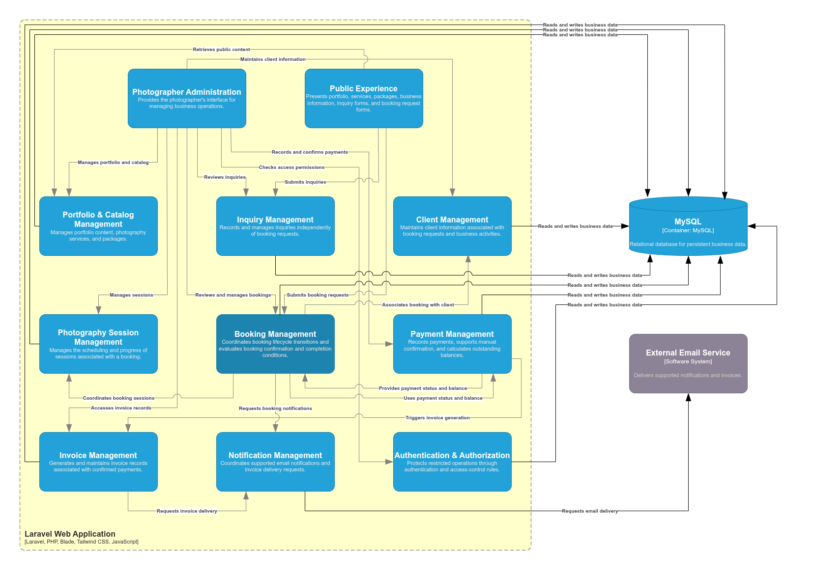

# C4 Component Diagram

## 1. Purpose

This document describes the internal logical components of the Laravel Web Application using the C4 Model at Level 3 (Component).

It identifies the main components within the application container, their responsibilities, and their interactions. It refines the container-level architecture documented in `04-c4-container.md` and connects the system overview to the detailed design work planned for Sprint 2.

The diagram focuses on logical responsibilities within the monolithic application. It does not represent every class, method, database table, or framework package.

The proposed component boundaries are based on the current system overview, requirements, use cases, booking lifecycle, domain events, ubiquitous language, and conceptual domain model.

They are preliminary design boundaries, not a final definition of Bounded Contexts, Aggregates, or Clean Architecture layers.

---

## 2. Scope and Status

The component diagram covers the internal responsibilities of the **Laravel Web Application** container.

It includes:

- Public-facing interactions.
- Photographer administration.
- Portfolio, service, and package management.
- Inquiry and client management.
- Booking and photography session management.
- Payment tracking and confirmation.
- Invoice generation.
- Notification coordination.
- Authentication and authorization.

The following remain outside the Laravel application container:

- **MySQL:** Persistent relational data storage.
- **External Email Service:** Delivery of supported email notifications and invoices.
- **External Payment Channels:** Bank transfer, cash, or other agreed methods through which payments are received.

The browser is an access channel, not a component inside the server-side application container.

### Status

**Status: Proposed — Sprint 2, System Design.**

The system uses a monolithic architecture, but the detailed component boundaries and their dependency rules remain subject to review. The strategic domain design, tactical domain design, and Clean Architecture documentation must be completed before these boundaries are treated as final implementation rules.

---

## 3. C4 Component Diagram

The authoritative diagram will be maintained as an editable Draw.io file using the C4 shape library.

- **Editable source:** `docs/03-architecture/diagrams/05-c4-component.drawio`
- **Exported preview:** `docs/03-architecture/diagrams/05-c4-component.drawio.png`

---

## 4. Component Responsibilities

### 4.1. Public Experience

**Responsibility**

Provides the public-facing experience for visitors and clients.

It coordinates the presentation of:

- Portfolio content.
- Photography services and packages.
- Business information.
- Inquiry submission forms.
- Booking request submission forms.

It accepts public interactions and delegates business operations to the appropriate application components rather than implementing business rules directly in presentation code.

**Primary collaborators**

- Portfolio & Catalog Management
- Inquiry Management
- Booking Management

**Important constraint**

Submitting an inquiry does not automatically create a Client or a Booking.

---

### 4.2. Photographer Administration

**Responsibility**

Provides the photographer's administrative interface for managing business operations.

It exposes the supported administrative workflows for:

- Portfolio and catalog maintenance.
- Inquiry review.
- Booking review and lifecycle management.
- Client information management.
- Photography session management.
- Payment recording and confirmation.
- Invoice-related activities.

It delegates operations to the relevant business components and does not own their business rules merely because the operations are initiated through its interface.

**Primary collaborators**

- Authentication & Authorization
- Portfolio & Catalog Management
- Inquiry Management
- Client Management
- Booking Management
- Photography Session Management
- Payment Management
- Invoice Management

**Important constraint**

The administrative interface is part of the Laravel application. It is not a separate frontend application or backend service.

---

### 4.3. Portfolio & Catalog Management

**Responsibility**

Manages the business information required to present photography work and available services.

Its responsibilities include:

- Organizing portfolio content and photography work.
- Managing services and their descriptions.
- Managing predefined packages and their associated information.
- Providing the information needed by public pages and administrative workflows.

**Primary collaborators**

- Public Experience
- Photographer Administration
- MySQL

**Important constraint**

The component does not represent a photo-editing application or a complete client photo-delivery and gallery-sharing system.

File and image storage remains an infrastructure concern whose implementation is to be defined in the relevant design and deployment documentation.

---

### 4.4. Inquiry Management

**Responsibility**

Manages inquiries submitted by visitors or existing clients.

Its responsibilities include:

- Accepting and recording inquiries.
- Making inquiry information available to the photographer.
- Supporting the inquiry-handling workflow.
- Maintaining inquiry status and related information as defined by the requirements.

**Primary collaborators**

- Public Experience
- Photographer Administration
- MySQL

**Important constraints**

- An inquiry is independent of the booking lifecycle.
- An inquiry does not automatically create a Client or a Booking.
- If an inquiry later leads to a booking, the booking follows its own lifecycle.

The precise inquiry states and transitions must remain consistent with the requirements and approved state design.

---

### 4.5. Client Management

**Responsibility**

Maintains client information associated with booking requests and subsequent business interactions.

Its responsibilities include:

- Creating or associating client records according to the agreed business rules.
- Maintaining relevant client contact information.
- Providing client information to authorized booking and administrative workflows.

**Primary collaborators**

- Public Experience
- Photographer Administration
- Booking Management
- MySQL

**Important constraint**

According to the current domain model, a visitor becomes a Client when they submit a Booking Request. Submitting an inquiry alone does not create a Client.

Authentication accounts and Client domain records must not be treated as equivalent concepts unless a later design decision explicitly establishes that relationship.

---

### 4.6. Booking Management

**Responsibility**

Coordinates the Booking lifecycle and ensures that booking transitions comply with the rules defined in `docs/02-analysis/03-booking-lifecycle.md`.

Its responsibilities include:

- Recording submitted booking requests.
- Supporting review and requests for additional information.
- Coordinating approval and rejection.
- Supporting cancellation and permitted booking updates.
- Coordinating confirmation after the required initial payment has been confirmed.
- Tracking the booking's overall progress.
- Determining whether the conditions for completion have been satisfied.

**Primary collaborators**

- Public Experience
- Photographer Administration
- Client Management
- Photography Session Management
- Payment Management
- MySQL

**Important constraints**

- A Booking begins in the `Submitted` state.
- An approved booking must satisfy the required initial payment condition before it becomes `Confirmed`.
- A Booking may contain one or more Photography Sessions.
- A Booking may have multiple payments.
- A Booking becomes `Completed` only when all required Photography Sessions are complete and the outstanding balance is zero.
- Completing an individual Photography Session does not, by itself, complete the Booking.

Booking Management coordinates these lifecycle decisions. The final mechanism for obtaining payment and session information—direct application-level collaboration, defined interfaces, or domain events—must be established during detailed design.

---

### 4.7. Photography Session Management

**Responsibility**

Manages the Photography Sessions associated with a Booking.

Its responsibilities include:

- Maintaining session scheduling information.
- Recording session details required by the business.
- Tracking the progress and completion of individual sessions.
- Providing session status to the booking-completion workflow.

**Primary collaborators**

- Photographer Administration
- Booking Management
- MySQL

**Important constraint**

A Photography Session and a Booking are distinct domain concepts. Completing one session does not automatically complete the overall Booking.

Whether a Session is modeled as an independent Aggregate or within another consistency boundary remains an open tactical design decision.

---

### 4.8. Payment Management

**Responsibility**

Records payments and maintains their confirmation status and contribution toward the Booking's financial completion.

Its responsibilities include:

- Recording payments received through external payment channels.
- Allowing the photographer to confirm receipt after manual verification.
- Maintaining payment history and confirmation information.
- Recalculating the outstanding Booking balance from the agreed total and confirmed payments.
- Providing payment-confirmation information to workflows that depend on it.
- Initiating or enabling the invoice-generation workflow after payment confirmation.

**Primary collaborators**

- Photographer Administration
- Booking Management
- Invoice Management
- MySQL

**Important constraints**

- The platform does not process bank transfers or cash payments directly.
- The photographer verifies and confirms payment receipt.
- A Booking may have any number of payments required by the agreed business terms; the system must not assume exactly two payments.
- Payment confirmation is distinct from the creation of the payment record.
- Payment confirmation can affect Booking confirmation and outstanding-balance calculations.

The final ownership of payment entities and their consistency boundary must be established during Tactical Design. This document does not assume that Payment is necessarily an independent Aggregate or necessarily an entity inside the Booking Aggregate.

---

### 4.9. Invoice Management

**Responsibility**

Generates and maintains invoice records associated with confirmed payments.

Its responsibilities include:

- Generating an invoice for each confirmed payment according to the agreed business rule.
- Maintaining the association between an invoice, its payment, and the relevant client or booking information.
- Persisting invoice records.
- Making invoice information available to authorized administrative workflows.
- Initiating the supported invoice-delivery workflow.

**Primary collaborators**

- Photographer Administration
- Payment Management
- Notification Management
- MySQL

**Important constraints**

- Invoice generation is distinct from invoice email delivery.
- A delivery failure does not mean the invoice was not generated.
- Invoice generation is not deferred until the Booking is fully paid; each confirmed payment may have its own invoice.

The detailed invoice data, numbering rules, immutability requirements, and correction policy must be defined in the relevant design documents.

---

### 4.10. Notification Management

**Responsibility**

Coordinates the delivery of supported business emails through the external Email Service.

Its responsibilities include:

- Preparing or coordinating the information required for an email.
- Requesting invoice delivery.
- Coordinating supported booking-related notifications.
- Handling delivery outcomes according to the eventual integration design.

**Primary collaborators**

- Invoice Management
- Booking Management, where supported notifications require booking-related information
- External Email Service

**Important constraints**

- The external Email Service performs delivery; Notification Management coordinates it.
- Email delivery is not the same business operation as generating an invoice or confirming a payment.
- The email provider has not yet been selected.
- Retry, failure handling, and delivery-status tracking remain to be specified.

Notification Management is a proposed logical responsibility, not a commitment to introduce a queue worker or separate notification service.

---

### 4.11. Authentication & Authorization

**Responsibility**

Provides the security mechanisms needed to protect administrative operations and other restricted functionality.

Its responsibilities include:

- Authenticating users where authentication is required.
- Enforcing authorization rules for protected operations.
- Restricting access to photographer administration and other protected capabilities.
- Supporting consistent access-control enforcement across application workflows.

**Primary collaborators**

- Photographer Administration
- Protected application operations

**Important constraints**

- Authentication and authorization are distinct from the Client domain concept.
- Visitors can submit public inquiries and booking requests without first creating an account, as specified in the current system overview.
- Requirements for client accounts and authenticated client operations remain subject to the requirements and security design.

The exact authentication mechanism, account model, and authorization policy are not determined by this component diagram.

---

## 5. Component Interactions

The following table summarizes the principal interactions that the diagram should communicate.

| Source component | Destination component or system | Interaction |
|---|---|---|
| Public Experience | Portfolio & Catalog Management | Retrieves public portfolio, service, and package information. |
| Public Experience | Inquiry Management | Submits and retrieves permitted inquiry information. |
| Public Experience | Booking Management | Submits booking requests and performs permitted public booking actions. |
| Photographer Administration | Authentication & Authorization | Applies access control to protected administrative operations. |
| Photographer Administration | Portfolio & Catalog Management | Manages portfolio content, services, and packages. |
| Photographer Administration | Inquiry Management | Reviews and manages inquiries. |
| Photographer Administration | Client Management | Maintains permitted client information. |
| Photographer Administration | Booking Management | Reviews requests and performs permitted booking-management operations. |
| Photographer Administration | Photography Session Management | Manages session details and progress. |
| Photographer Administration | Payment Management | Records payments and confirms receipt after manual verification. |
| Photographer Administration | Invoice Management | Accesses invoice-related administrative operations. |
| Booking Management | Client Management | Associates a booking request with the appropriate Client record. |
| Booking Management | Photography Session Management | Coordinates the sessions associated with a Booking and uses their completion status when evaluating booking completion. |
| Booking Management | Payment Management | Uses payment-related information to evaluate confirmation and financial-completion conditions. |
| Payment Management | Invoice Management | Initiates invoice generation after payment confirmation. |
| Invoice Management | Notification Management | Requests delivery of a generated invoice. |
| Notification Management | External Email Service | Requests email delivery and handles supported delivery outcomes. |
| Business components | MySQL | Persist and retrieve the data required for their responsibilities. |

The table describes logical responsibilities. It does not prescribe direct method calls, event names, interfaces, or transaction boundaries.

The exact communication mechanisms must be aligned with the approved application architecture and domain-event design.

---

## 6. Data Persistence and External Dependencies

### 6.1. MySQL

The Laravel Web Application accesses MySQL for persistent business data.

The component diagram may show the relevant components interacting with the database, but it should not duplicate the detailed database schema or imply that every component necessarily owns a separate database.

The initial architecture uses a shared relational database within the monolithic application. The exact table ownership, transaction boundaries, and persistence abstractions remain subject to database and tactical design.

### 6.2. External Email Service

Notification Management coordinates email delivery through the external Email Service.

Invoice Management remains responsible for invoice generation and records. An email-delivery failure must not invalidate the fact that an invoice was generated.

The provider and integration mechanism remain unspecified.

### 6.3. External Payment Channels

Bank transfers, cash, and other agreed payment methods remain outside the application.

The Photographer verifies receipt and records the confirmation through Payment Management. The component diagram must not imply that the platform directly processes these external payments.

### 6.4. File and Image Storage

Portfolio images and other application files require storage, but the implementation and deployment arrangement have not yet been selected.

File and image storage should be documented as an infrastructure dependency when its actual boundary and technology are defined. This component diagram does not introduce a separate storage service without an approved decision.

---

## 7. Architectural Constraints and Design Considerations

### 7.1. Monolithic Deployment

All proposed application components reside within the same Laravel Web Application container.

The components are logical divisions of responsibility, not independently deployable services.

### 7.2. Separation of Responsibilities

Presentation components coordinate user interactions and delegate business operations. Business components implement or coordinate their assigned workflows. Infrastructure integrations remain distinct from the business operations that trigger them.

The final separation between Domain, Application, and Infrastructure layers will be documented in `06-clean-architecture.md`.

### 7.3. Domain-Driven Design

The proposed components are informed by the current domain model and ubiquitous language.

However, a logical component is not automatically a Bounded Context, Aggregate, or Domain Service. Those concepts must be defined and validated through Strategic Design and Tactical Design.

### 7.4. Booking Lifecycle Consistency

Booking Management coordinates the overall Booking lifecycle. Payment Management and Photography Session Management provide the information required to evaluate the relevant lifecycle rules.

The final design must specify how state changes are coordinated, how consistency is maintained, and how failures are handled. This document does not prematurely prescribe those implementation details.

### 7.5. Invoice and Notification Separation

Invoice generation and email delivery are separate responsibilities.

The design must preserve invoice records independently of email-delivery outcomes and must avoid duplicating invoices unintentionally when delivery is retried.

The exact idempotency, retry, and failure-handling mechanisms remain to be specified.

### 7.6. Authentication and Client Identity

Client domain records and authentication accounts are separate concepts unless the requirements and design establish an explicit relationship.

Public inquiry and booking submission must remain consistent with the current requirement that an account is not required merely to submit either form.

### 7.7. Testability

Component responsibilities and interactions should be defined so that business behavior can be tested without unnecessarily depending on framework or infrastructure details.

The detailed testing boundaries, test types, and TDD workflow will be specified in the testing documentation and aligned with the final architecture.

---

## 8. Decisions Still to Be Finalized

The following questions must be resolved through the appropriate design work rather than assumed by this diagram:

1. The final Bounded Contexts and their relationships.
2. The Aggregate Roots and consistency boundaries for Booking, Photography Session, Payment, Invoice, Client, Inquiry, and catalog-related concepts.
3. The detailed separation of Domain, Application, and Infrastructure responsibilities.
4. The communication contracts between components and the use of domain events where appropriate.
5. Transaction boundaries for booking confirmation, payment confirmation, invoice generation, and booking completion.
6. The persistence abstractions and data-access responsibilities.
7. The authentication and authorization model.
8. The email provider, delivery integration, retries, and failure handling.
9. The file and image storage implementation.
10. The mechanisms used to prevent duplicate invoice generation and safely retry email delivery.

These decisions must be documented in the relevant Strategic Design, Tactical Design, Clean Architecture, database, domain-event, security, and deployment artifacts as they are approved.

---

## 9. Relationship to Other Architecture Artifacts

| Document | Relationship |
|---|---|
| `docs/03-architecture/01-system-overview.md` | Establishes the system purpose, scope, major logical components, and principal workflows. |
| `docs/03-architecture/02-project-structure.md` | Defines the repository structure and planned application source root. |
| `docs/03-architecture/03-c4-context.md` | Defines the system boundary, people, and external systems. |
| `docs/03-architecture/04-c4-container.md` | Defines the runtime containers and their communication. |
| `docs/03-architecture/06-clean-architecture.md` | Will define architectural layers and dependency rules. |
| `docs/03-architecture/adrs/ADR-002-monolith.md` | Records the monolithic architecture decision. |
| `docs/03-architecture/adrs/ADR-003-blade.md` | Records the Blade decision. |
| `docs/03-architecture/adrs/ADR-004-tailwind-css.md` | Records the Tailwind CSS decision. |
| `docs/03-architecture/adrs/ADR-005-ddd.md` | Records the DDD decision. |
| `docs/03-architecture/adrs/ADR-006-tdd.md` | Records the TDD decision. |
| `docs/01-requirements/06-functional-requirements.md` | Defines required business capabilities. |
| `docs/01-requirements/07-non-functional-requirements.md` | Defines quality and operational requirements. |
| `docs/02-analysis/03-booking-lifecycle.md` | Defines booking states, transitions, and business rules. |
| `docs/02-analysis/04-domain-events.md` | Documents domain events and their intended meanings. |
| `docs/02-analysis/05-ubiquitous-language.md` | Establishes shared domain terminology. |
| `docs/02-analysis/06-domain-model.md` | Describes the conceptual domain model and provisional aggregate candidates. |
| `docs/04-design/01-strategic-design.md` | Will define the strategic domain design. |
| `docs/04-design/02-tactical-design.md` | Will define tactical domain patterns and detailed domain boundaries. |
| `docs/04-design/database/01-conceptual-model.md` | Defines the conceptual database model. |
| `docs/05-testing/01-testing-strategy.md` | Defines the testing strategy. |

---

## 10. Document Maintenance

Update this document when an approved design decision materially changes:

- A component's responsibility.
- The relationships between components.
- The boundary between the Laravel application and external systems.
- The persistence or integration responsibilities.
- The selected application architecture or domain boundaries.

The editable Draw.io source and exported preview must be kept consistent with the component definitions and interaction table.

Changes must also be reflected in any related architecture, domain-analysis, database, testing, or deployment documents affected by the decision.

The diagram and this document must not describe proposed components as implemented code until the corresponding implementation exists.

---

## 11. Current Status

This document establishes a **proposed component-level view** for Sprint 2 — System Design.

It is based on the current system overview, repository structure, C4 Context Diagram, C4 Container Diagram, and domain-analysis artifacts.

It does not mark Sprint 2 as complete. Component boundaries and interactions must be reviewed against the strategic domain design, tactical domain design, and Clean Architecture rules before the design is considered final.

Laravel application scaffolding remains planned for Sprint 3, after the relevant design decisions have been approved.

---

