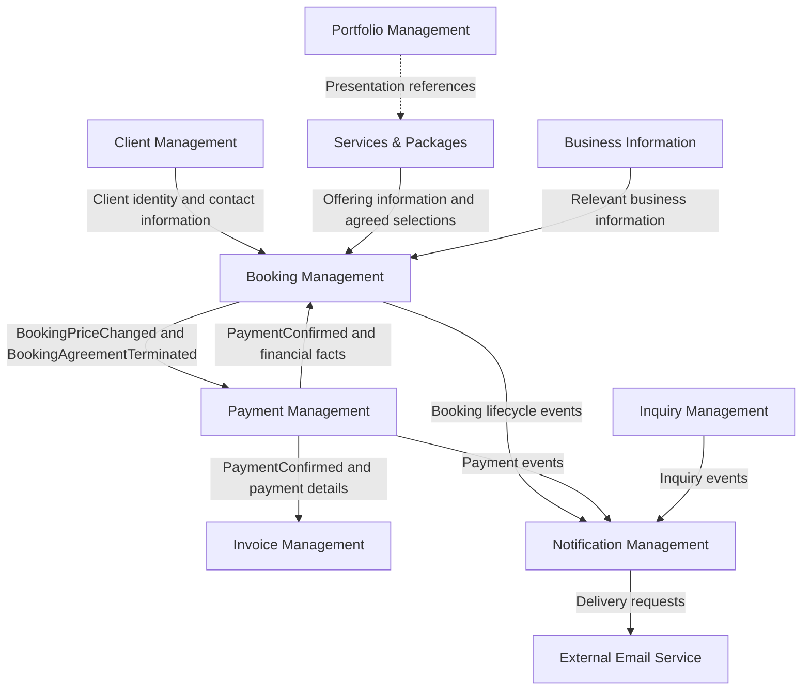

# Strategic Design

**Document:** `docs/04-design/01-strategic-design.md`  
**Version:** 1.0.0  
**Status:** Approved — Strategic Baseline  
**Project:** Photography Business Platform  
**Sprint:** Sprint 2 — System Design

## 1. Purpose

This document defines the strategic domain design of the Photography Business Platform. It establishes the major business areas, Bounded Contexts, their responsibilities, ownership boundaries, and communication relationships.

It provides the strategic foundation for Tactical Design, where aggregate boundaries, entities, value objects, application services, domain events, and integration contracts will be refined.

The decisions in this document are the authoritative strategic baseline. Existing analysis documents will be synchronized with these decisions after Strategic Design and Tactical Design are complete.

---

## 2. Scope

The platform supports a single photography business operated by one photographer or an authorized administrator.

The initial version includes:

- Public portfolio and photography service offerings.
- Services and packages.
- Client inquiries.
- Booking requests and booking lifecycle management.
- Photography sessions associated with bookings.
- Client records and contact information.
- Manual payment recording and confirmation.
- Invoice generation for confirmed payments.
- Business information management.
- Notifications through external delivery channels.
- Authentication and authorization for protected operations.
- Arabic and English localization.

---

### 2.1 Out of Scope

The initial version does not include:

- A marketplace for multiple independent photographers.
- Social networking features.
- Real-time messaging.
- Image editing or enhancement tools.
- Client photo galleries or photo-delivery workflows.
- An integrated online payment gateway.
- Direct integration with third-party accounting systems.

Payments are recorded and confirmed manually by the photographer, based on payment channels such as cash or bank transfer.

---

## 3. Strategic Design Principles

The following principles govern the design of the platform.

### 3.1 Explicit Business Ownership

Each Bounded Context owns its business responsibilities and the data required to fulfil them. Another context must not directly modify that context's internal state.

---

### 3.2 Independent Business Rules

A context applies its own business rules when responding to information received from another context. Receiving an event does not authorize the receiving context to bypass its own rules.

---

### 3.3 Explicit Context Communication

Contexts communicate through defined contracts, domain events, or other explicitly designed interfaces. Direct access to another context's internal implementation must be avoided.

---

### 3.4 Business Facts and Business Decisions Are Different

A confirmed payment is a financial fact owned by Payment Management. Whether that payment satisfies the booking's confirmation requirements is a decision owned by Booking Management.

Likewise, completing a photography session does not automatically mean that the booking is complete.

---

### 3.5 Agreement Snapshots

A booking must preserve the relevant agreed terms, such as services, package details, price, schedule, and location, as required by the final domain model.

Changes to the current service catalog or business profile must not silently rewrite an existing booking agreement.

---

### 3.6 Separate Payment Confirmation, Booking Confirmation, and Invoice Generation

These are distinct business operations:

- Payment Management confirms a payment.
- Booking Management determines whether the booking can be confirmed.
- Invoice Management generates an invoice for each individually confirmed payment.
- Notification Management coordinates notification delivery.

One operation must not be treated as an automatic substitute for another.

---

### 3.7 Monolith First

All Bounded Contexts are logical boundaries within one Laravel monolithic application. They are not separate microservices.

The design must preserve clear module boundaries without introducing distributed-system complexity that the initial product does not require.

---

### 3.8 Reliable Event Processing

Event consumers must be designed to handle retries and duplicate delivery safely where applicable. Business operations such as invoice generation must not create duplicate business records when the same event is processed more than once.

---

### 3.9 Consistent Documentation

Requirements, domain analysis, strategic design, tactical design, architecture, database design, and implementation must ultimately describe the same approved business rules.

---

## 4. Domain Classification

Domain classification identifies the business significance of each area. It is separate from the decision to establish a Bounded Context.

| Domain area | Classification | Rationale |
|---|---|---|
| Booking Management | Core Domain | Coordinates the primary booking lifecycle and the agreement with the client. |
| Services & Packages | Supporting Domain | Defines the photography offerings and packages available for booking. |
| Client Management | Supporting Domain | Maintains client records and contact information. |
| Payment Management | Supporting Domain | Records and confirms payments and manages payment-related financial facts. |
| Invoice Management | Supporting Domain | Generates and manages invoices associated with confirmed payments. |
| Inquiry Management | Supporting Domain | Handles independent inquiries from visitors and clients. |
| Portfolio Management | Supporting Domain | Presents the photographer's work and supports public discovery. |
| Business Information | Supporting Domain | Maintains public business details used by the platform. |
| Notification Management | Cross-cutting delivery capability | Coordinates business notifications, templates, delivery attempts, and failures. |
| Authentication & Authorization | Generic capability | Provides identity verification and access control. |
| Localization | Generic capability | Supports Arabic and English interfaces and localized content. |
| File Storage | Generic capability | Provides storage and retrieval of platform files and portfolio media. |

Notification Management is treated as an explicit logical context because it has defined responsibilities and boundaries. Its classification as a cross-cutting capability does not prevent it from being designed as a distinct module.

Portfolio Management remains a separate Bounded Context even though it is a Supporting Domain rather than the Core Domain.

---

## 5. Bounded Contexts

The initial strategic design defines the following Bounded Contexts.

### 5.1 Booking Management

**Classification:** Core Domain

**Purpose:** Manage booking requests, agreed booking terms, and the booking lifecycle.

**Responsibilities:**

- Receive and manage booking requests.
- Coordinate the booking agreement with the client.
- Request or record additional booking information.
- Approve or reject booking requests.
- Record changes to agreed booking terms.
- Manage booking confirmation, termination, and completion.
- Manage photography sessions associated with a booking.
- Determine whether session completion and financial conditions satisfy booking completion rules.
- Maintain the booking's agreed terms and lifecycle state.

**Ownership boundary:**

Booking Management owns booking records, booking lifecycle decisions, and the business interpretation of whether a booking satisfies its confirmation and completion requirements.

It does not own:

- Client master records.
- The current service and package catalog.
- Payment recording or payment confirmation.
- Invoice generation.
- Notification delivery.

**Booking confirmation rule:**

A booking is confirmed only after Payment Management confirms a payment that satisfies the required initial-payment condition and Booking Management applies its own confirmation rule.

Payment Management reports the financial fact; it does not directly change the booking's status.

**Booking completion rule:**

A booking is completed only when:

1. All required photography sessions are complete.
2. The remaining balance is zero.

Completing an individual session is not sufficient to complete a booking.

**Photography sessions:**

Photography sessions belong to the Booking Management context in the strategic design. `PhotographySessionStarted` and `PhotographySessionCompleted` are internal domain events within this context.

Whether a session is ultimately modelled as an entity within the Booking Aggregate or as a separate Aggregate in the same context is a Tactical Design decision. This does not change the strategic ownership of session management.

---

### 5.2 Payment Management

**Classification:** Supporting Domain

**Purpose:** Manage payment records and payment-related financial facts independently of the booking lifecycle.

**Responsibilities:**

- Record payments against the relevant booking.
- Confirm or reject recorded payments.
- Maintain payment status and confirmation details.
- Track confirmed payment amounts.
- Maintain the financial information required to determine amounts paid and outstanding.
- Record and manage refunds, where applicable.
- Communicate confirmed payments and relevant financial changes to other contexts.

**Ownership boundary:**

Payment Management owns payment recording, payment confirmation, and refund-related payment operations.

Payment is not owned by the Booking Aggregate. A relationship between a booking and its payments does not imply that Booking Management owns payment records or payment-confirmation rules.

**Relationship with Booking Management:**

Payment Management provides payment and financial facts through explicit contracts or events. Booking Management uses those facts to evaluate its own booking rules.

**Relationship with Invoice Management:**

A confirmed payment provides the financial fact on which Invoice Management can base invoice generation. Payment Management does not generate invoices itself.

**Financial consistency:**

The design must preserve confirmed payment records when the agreed booking price changes. Recalculating the outstanding balance must not erase or silently alter the history of confirmed payments.

The exact financial model, amount calculations, and contract payloads will be defined in Tactical Design.

---

### 5.3 Client Management

**Classification:** Supporting Domain

**Purpose:** Maintain client records and the contact information needed by the platform.

**Responsibilities:**

- Maintain client identity and contact details.
- Provide client information to authorized contexts through defined interfaces.
- Support the association between clients and their bookings, inquiries, and invoices.
- Maintain the client record independently of individual booking lifecycles.

**Business rule:**

Submitting an inquiry alone does not create a client record.

A visitor becomes or is identified as a client when submitting a Booking Request, according to the final client-creation and identity-matching rules.

A visitor does not automatically become an authenticated account holder merely by becoming a client.

---

### 5.4 Services & Packages

**Classification:** Supporting Domain

**Purpose:** Define and maintain the photography offerings available to clients.

**Responsibilities:**

- Maintain photography service definitions.
- Maintain package definitions.
- Define the services included in each package.
- Maintain current catalog descriptions, prices, and offering details.
- Provide offering information for public presentation and booking requests.

**Business rules:**

A package consists of one or more services.

A booking may concern an individual service, a package, one photography session, or multiple sessions scheduled on different days.

Services & Packages owns the current catalog. Booking Management owns the agreed booking terms once an agreement is established.

Subsequent catalog changes must not silently alter the agreed terms of an existing booking.

---

### 5.5 Invoice Management

**Classification:** Supporting Domain

**Purpose:** Generate and manage invoices associated with confirmed payments.

**Responsibilities:**

- Generate an invoice for each individually confirmed payment.
- Associate each invoice with the relevant payment and client.
- Maintain invoice records and identifiers.
- Present the amount represented by the individual payment.
- Show the cumulative amount paid and remaining balance, where required.
- Support the retrieval of invoice information for authorized users and notification workflows.

**Invoice generation rule:**

**Every individually confirmed payment must have its own invoice.** Invoice generation does not wait until the entire booking has been paid.

Each invoice represents the relevant confirmed payment and includes the required cumulative financial information, including the remaining balance.

Invoice generation is separate from invoice delivery. A failed email delivery must not be treated as a failed invoice-generation operation.

**Ownership boundary:**

Invoice Management owns invoice creation and invoice records. Payment Management owns payment confirmation. Booking Management owns booking lifecycle decisions.

Previously issued invoices must not be silently rewritten when the agreed booking price changes. Any correction, adjustment, or replacement-invoice rules must be defined in Tactical Design and validated against applicable accounting and legal requirements.

---

### 5.6 Inquiry Management

**Classification:** Supporting Domain

**Purpose:** Handle inquiries independently of the booking process.

**Responsibilities:**

- Receive and maintain inquiries from visitors and existing clients.
- Store the inquiry's relevant contact information and message.
- Manage the inquiry lifecycle and handling status.
- Support communication with the photographer or administrator.

**Business rules:**

- An inquiry can be submitted by a visitor or an existing client.
- An inquiry does not require a booking.
- An inquiry alone does not create a client record.
- An inquiry does not automatically create a booking request or booking.

---

### 5.7 Portfolio Management

**Classification:** Supporting Domain

**Purpose:** Present the photographer's work to visitors.

**Responsibilities:**

- Maintain portfolio content.
- Organize content into albums and categories.
- Manage image descriptions and publication status.
- Support the public browsing experience.

Portfolio Management may use references to services or categories for presentation and navigation. It does not own service definitions or booking rules.

Client galleries and photo-delivery workflows are outside the initial product scope.

---

### 5.8 Business Information

**Classification:** Supporting Domain

**Purpose:** Maintain public information about the photography business.

**Responsibilities:**

- Maintain the business name and public contact information.
- Maintain relevant public location and business details.
- Provide business information to the public website and other authorized contexts.

If particular business information becomes part of an agreed booking term, Booking Management must preserve the relevant agreed value when required. A later change to the public business profile must not silently rewrite an existing agreement.

---

### 5.9 Notification Management

**Classification:** Cross-cutting delivery capability

**Purpose:** Coordinate the creation and delivery of notifications resulting from business events.

**Responsibilities:**

- Identify which business events require notifications.
- Map business events to notification types.
- Select appropriate templates and recipients.
- Coordinate delivery through external services, initially an Email Service.
- Track delivery attempts and failures.
- Support retries and safe handling of repeated requests.

**Ownership boundary:**

Notification Management owns notification orchestration and delivery state. It does not own the business decision that triggered a notification.

For example, a notification about a confirmed booking reports the decision made by Booking Management; Notification Management does not confirm the booking itself.

A failed notification must not reverse a confirmed payment, cancel an invoice, or undo a booking decision.

---

### 5.10 Generic Capabilities

Authentication & Authorization, Localization, and File Storage are treated as shared technical capabilities in the initial design rather than separate Bounded Contexts.

They must still have explicit interfaces and access rules. Their implementation and placement within the Laravel application will be refined during architecture and Tactical Design.

---

## 6. Context Relationships and Information Ownership

The following table describes the primary relationships. It defines strategic information flows, not final event payloads or implementation details.

| Source | Consumer | Information or contract | Purpose |
|---|---|---|---|
| Services & Packages | Booking Management | Service and package offering information | Support booking requests and preserve agreed offering details. |
| Client Management | Booking Management | Client identity and relevant contact information | Associate bookings with the correct client. |
| Booking Management | Payment Management | Agreed price changes and agreement-termination information | Keep payment-related financial processing aligned with agreed booking terms. |
| Payment Management | Booking Management | `PaymentConfirmed` and relevant financial facts | Allow Booking Management to evaluate confirmation, balance, and completion rules. |
| Payment Management | Invoice Management | `PaymentConfirmed` and payment details | Enable invoice generation for each confirmed payment. |
| Booking Management | Notification Management | Relevant booking lifecycle events | Trigger booking-related notifications. |
| Payment Management | Notification Management | Relevant payment events | Trigger payment-related notifications. |
| Inquiry Management | Notification Management | Relevant inquiry events | Trigger inquiry-related notifications. |
| Portfolio Management | Services & Packages | Presentation references, where needed | Support catalog navigation without transferring service ownership. |
| Business Information | Other contexts | Relevant public business information | Provide business details without granting ownership of booking or payment data. |
| Notification Management | External Email Service | Delivery requests | Send notifications through an external delivery channel. |

The precise contracts, payloads, consistency guarantees, and failure-handling strategies will be finalized in Tactical Design.

### 6.1 No Direct Cross-Context State Mutation

A consumer must not directly modify another context's internal records or bypass its business rules.

For example:

- Payment Management reports a confirmed payment; Booking Management decides whether the booking can be confirmed.
- Booking Management communicates an agreed price change; Payment Management applies the relevant financial rules.
- Payment Management reports a confirmed payment; Invoice Management applies its own invoice-generation rules.
- Notification Management delivers a message; it does not alter the underlying business state.

---

## 7. Domain Events and Ownership

Domain events represent business facts that have occurred. Their ownership follows the context responsible for the relevant business decision or operation.

### 7.1 Booking Management Events

Booking Management owns the following events:

- `BookingRequestSubmitted`
- `BookingRequestUpdated`
- `BookingRequestCancelled`
- `AdditionalBookingInformationRequested`
- `AdditionalBookingInformationProvided`
- `BookingRequestApproved`
- `BookingRequestRejected`
- `BookingConfirmed`
- `PhotographySessionStarted`
- `PhotographySessionCompleted`
- `BookingCompleted`

The booking request events describe the progress of a request. `BookingConfirmed` describes the booking's transition to a confirmed state after the required payment condition is satisfied. `BookingCompleted` describes the completion of the overall booking.

`PhotographySessionStarted` and `PhotographySessionCompleted` are internal domain events within Booking Management. They are not, by themselves, cross-context integration events.

---

### 7.2 Payment Management Events

Payment Management owns:

- `PaymentRecorded`
- `PaymentConfirmed`
- `RefundConfirmed`

`RefundConfirmed` is an approved strategic event. Its exact lifecycle, eligibility rules, and event payload will be defined in Tactical Design and reflected in the canonical domain-events document.

`PaymentConfirmed` communicates a confirmed financial fact. It does not itself mean that a booking is confirmed or completed.

---

### 7.3 Invoice Management Events

Invoice Management owns:

- `InvoiceGenerated`

`InvoiceGenerated` indicates that an invoice has been generated. It does not assert that the invoice has been successfully emailed or otherwise delivered.

---

### 7.4 Additional Approved Strategic Events

The following events are approved strategic decisions and must be incorporated into the canonical event documentation:

- `BookingPriceChanged` — Booking Management communicates a change to the agreed booking price.
- `BookingAgreementTerminated` — Booking Management communicates that the booking agreement has been terminated.
- `RefundConfirmed` — Payment Management communicates that a refund has been confirmed.

Their final payloads, triggering conditions, versioning, delivery guarantees, and consumer behavior remain Tactical Design concerns.

---

### 7.5 Event Consumption Rules

A context that consumes an event must interpret it according to its own responsibilities.

For example:

1. Payment Management emits `PaymentConfirmed`.
2. Booking Management evaluates whether the confirmed payment satisfies the initial-payment requirement and updates the booking state when its own rules permit.
3. Invoice Management applies its invoice-generation rules and generates the invoice for that payment.
4. Notification Management determines whether notifications are required.

These are distinct reactions to a shared business fact. They must not be implemented as one context directly mutating the internal state of another.

---

### 7.6 Booking Balance and Full Settlement

The financial condition that the remaining balance is zero is used by Booking Management when determining whether the booking can be completed.

A separate `BookingFullyPaid` event is not part of the approved event set at this stage. It must not be assumed to exist unless a later design decision explicitly introduces it.

---

## 8. Price Changes and Agreement Termination

Changes to an existing agreement require coordination between contexts while preserving their ownership boundaries.

### 8.1 Booking Price Changes

When the agreed booking price changes:

1. Booking Management records the approved change to the booking agreement.
2. Booking Management communicates the change through the approved `BookingPriceChanged` contract or event.
3. Payment Management updates the financial amount used for outstanding-balance calculations while preserving the history of confirmed payments.
4. Invoice Management evaluates whether any invoice-related action is required under its own rules.
5. Notification Management handles any required notifications.

A price change must not directly overwrite payment history or silently rewrite previously issued invoices.

The final rules for price-change authorization, effective dates, balance recalculation, and invoice adjustments will be specified in Tactical Design.

---

### 8.2 Agreement Termination

When an agreement is terminated:

1. Booking Management records the termination decision and relevant effective terms.
2. Booking Management communicates the termination through `BookingAgreementTerminated`.
3. Payment Management evaluates any payment-related consequences, including amounts due or potential refund eligibility.
4. Any refund must be handled and confirmed by Payment Management according to its own rules.
5. Invoice Management evaluates any required invoice-related action.
6. Notification Management coordinates the relevant notifications.

Agreement termination does not automatically mean that a full refund is due.

`BookingAgreementTerminated` and `RefundConfirmed` represent different facts owned by different contexts. Terminating an agreement does not itself confirm a refund.

A terminated booking must not be treated as `BookingCompleted` merely because its agreement has ended. The final booking termination states and their relationship to the booking lifecycle will be defined in Tactical Design.

---

## 9. Strategic Context Map

The diagram below summarizes the principal relationships between the logical contexts.

**Diagram notes:**

- Every box represents a logical module or an external dependency, not necessarily a separate deployable service.
- All platform contexts reside within the Laravel monolith.
- Arrows indicate conceptual information flow. They do not define final synchronous or asynchronous implementation mechanisms.
- The exact contracts and additional relationships may be refined during Tactical Design without changing the ownership decisions in this document.

---

## 10. Consistency and Reliability Requirements

The following requirements guide the implementation design.

### 10.1 Stable Identity

Cross-context references must use stable identifiers rather than depend on another context's internal object representation.

---

### 10.2 Idempotent Processing

Consumers must handle duplicate event delivery safely where relevant. In particular, processing the same confirmed-payment event repeatedly must not create duplicate invoices for the same payment.

---

### 10.3 Reliable State Changes

The implementation must consider the consistency between a business state change and the publication of its event. Transactional outbox or another appropriate reliability mechanism may be selected during architecture and Tactical Design if required.

---

### 10.4 Failure Visibility

Failed event processing and notification delivery must be observable and recoverable. Retrying a notification must not repeat the original business operation.

---

### 10.5 Financial Traceability

Confirmed payments and generated invoices must remain traceable to their associated booking, client, and payment records. Balance calculations must preserve the financial history required by the business.

---

### 10.6 Appropriate Complexity

The initial implementation must not introduce a message broker, distributed deployment, or microservices solely because the design uses Bounded Contexts or domain events. The chosen mechanisms must suit a modular Laravel monolith.

---

## 11. Decisions Deferred to Tactical Design

Strategic Design establishes responsibilities and boundaries. It does not prematurely fix all implementation details.

The following matters remain for Tactical Design:

1. Aggregate Roots and aggregate consistency boundaries within each context.
2. Whether Photography Session is an entity inside the Booking Aggregate or a separate Aggregate in Booking Management.
3. How Booking Management receives reliable financial facts without owning payment records.
4. How Payment Management receives and maintains the agreed booking amount.
5. The exact event payloads, identifiers, versioning, and consumer contracts.
6. Event publication, retries, idempotency, ordering, and failure recovery.
7. The exact booking, payment, and invoice state transitions.
8. The rules for price changes, termination, refunds, and invoice adjustments.
9. Invoice numbering, uniqueness constraints, and the exact relationship between payments and invoices.
10. The transaction boundaries and persistence strategy for each context.
11. The Laravel module structure and the placement of domain, application, and infrastructure code.
12. The test strategy for business rules, context contracts, and cross-context workflows.

These are implementation-design questions. They do not reopen the strategic decisions that each context owns its defined responsibilities.

---

## 12. Documentation Synchronization

The strategic decisions in this document are authoritative for subsequent design work. Existing documents must be reconciled after Strategic Design and Tactical Design are complete.

The synchronization work includes:

| Document | Required follow-up |
|---|---|
| `docs/02-analysis/04-domain-events.md` | Add the approved strategic events and clarify event ownership and the internal status of session events. |
| `docs/02-analysis/06-domain-model.md` | Align domain scope, context ownership, payment ownership, and aggregate candidates with the final strategic and tactical decisions. |
| `docs/02-analysis/03-booking-lifecycle.md` | Ensure booking confirmation, session completion, booking completion, and termination rules match the approved design. |
| `docs/02-analysis/05-ubiquitous-language.md` | Ensure the terms used for bookings, payments, invoices, sessions, and agreement termination remain consistent. |
| `docs/03-architecture/01-system-overview.md` | Ensure the logical components and their responsibilities match the approved context boundaries. |
| `docs/03-architecture/02-project-structure.md` | Reflect the final implementation boundaries after Tactical Design determines the Laravel module structure. |
| `docs/03-architecture/06-clean-architecture.md` | Align dependency direction and architectural boundaries with the final context and tactical design. |
| `docs/04-design/02-tactical-design.md` | Define the aggregates, contracts, events, state transitions, and implementation-level rules established by this strategic baseline. |

This table records required follow-up work; it does not imply that every listed document has already been updated or revalidated.

No implementation should rely on an undocumented assumption where a required business rule remains unresolved.

---

## 13. Related Documents

- `docs/00-project/roadmap.md`
- `docs/00-project/sprint-backlog.md`
- `docs/01-requirements/06-functional-requirements.md`
- `docs/01-requirements/07-non-functional-requirements.md`
- `docs/02-analysis/01-business-process.md`
- `docs/02-analysis/02-use-cases.md`
- `docs/02-analysis/03-booking-lifecycle.md`
- `docs/02-analysis/04-domain-events.md`
- `docs/02-analysis/05-ubiquitous-language.md`
- `docs/02-analysis/06-domain-model.md`
- `docs/03-architecture/01-system-overview.md`
- `docs/03-architecture/02-project-structure.md`
- `docs/03-architecture/06-clean-architecture.md`
- `docs/04-design/02-tactical-design.md`

---

